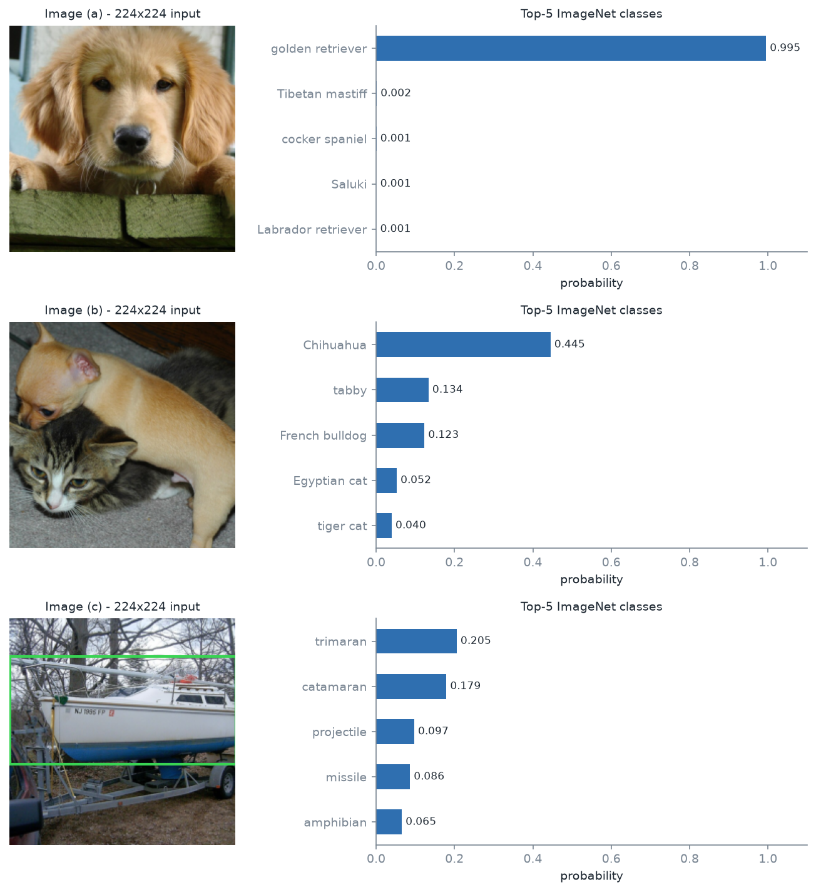
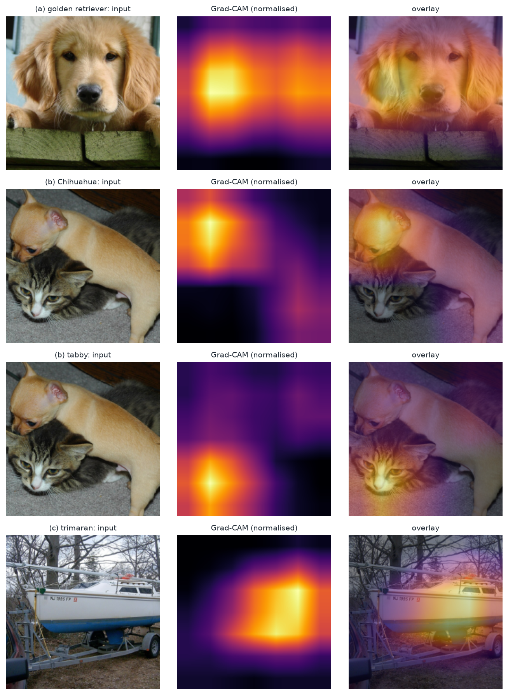
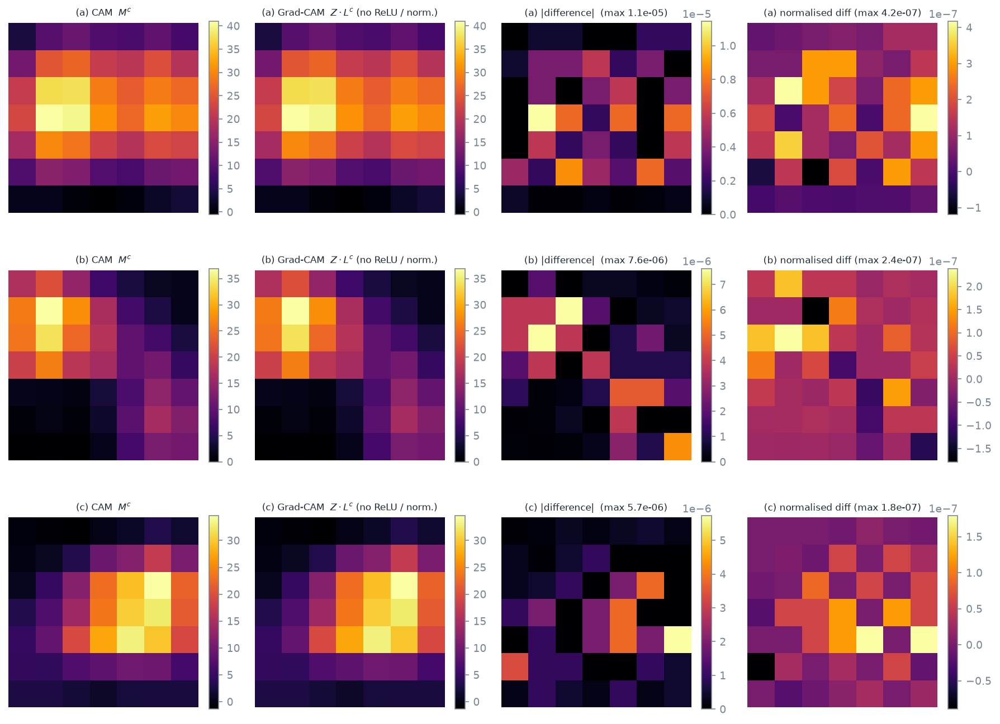
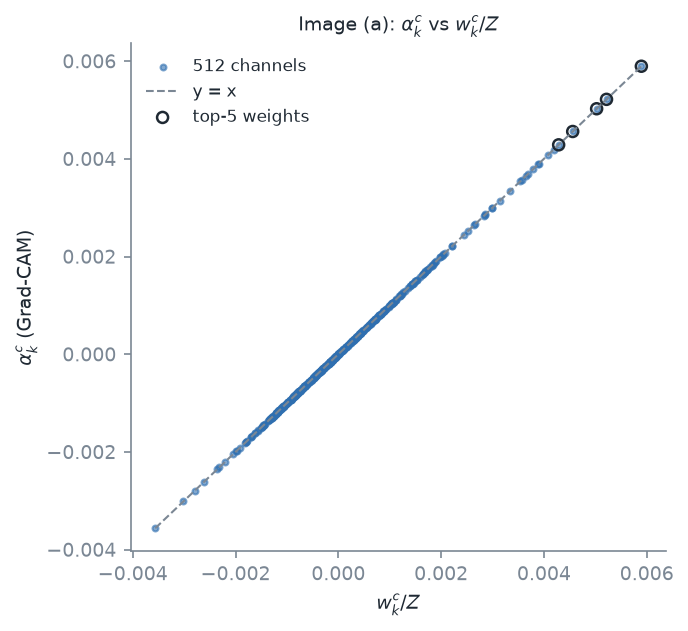
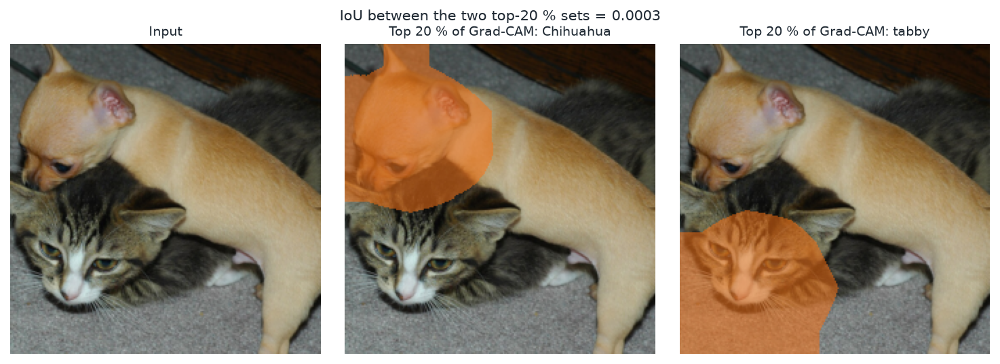
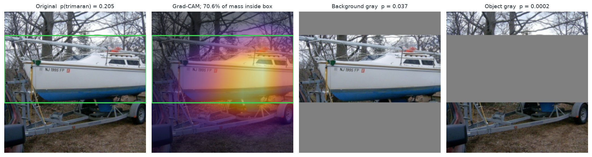

# Laboratorio de Explicabilidad - Task 1 (Entrega Parcial)

**Curso:** Deep Learning - Universidad del Valle de Guatemala

**Integrantes:**

- José Ruiz 
- José Auyón 
- Gerardo Fernández 

En este task se implementó Grad-CAM desde cero sobre un ResNet-18 preentrenado en ImageNet, se calculó CAM directamente
desde los pesos de la capa final y se verificó numéricamente que ambos métodos coinciden. Después se usaron los mapas para
analizar tres imágenes. Todo el código usa PyTorch, NumPy, SciPy y Matplotlib; no se usó `pytorch-grad-cam`, `captum`
ni librerías similares.

## Cómo levantar y correr el proyecto

Requisitos: Python 3.10 a 3.12 (lo desarrollamos con 3.11) y conexión a internet la primera vez, porque PyTorch descarga
los pesos de ResNet-18 (~45 MB). Las tres imágenes ya vienen en `data/images/`.

```bash
python3.11 -m venv .venv
source .venv/bin/activate          # Windows: .venv\Scripts\activate
pip install -r requirements.txt
pip install -e .                   # hace importable el paquete xai_lab

python -m pytest -q                # pruebas unitarias (13)
python scripts/run_task1.py        # corre todo el Task 1
```

Al correrlo, la consola imprime un bloque por inciso (`TASK 1.1`, `TASK 1.2`, `TASK 1.3`, `TASK 1.4(a)`, `(b)` y `(c)`)
con lo que calcula y los números obtenidos. Las figuras quedan en `outputs/task1/figures/` y los números en
`outputs/task1/results.json`. Tarda unos segundos en CPU. (`make setup`, `make test` y `make task1` hacen lo mismo.)

Estructura del código:

```
data/images.json     fuente, autor, licencia, SHA-256 y recuadro de cada imagen
src/xai_lab/
  gradcam.py         Grad-CAM con hooks de avance y retroceso (1.2)
  cam.py             CAM desde los pesos de fc (1.3)
  maps.py            ReLU/min-max, interpolación, máscara top-20 %, IoU, masa en recuadro
  causal.py          prueba causal con gris
  task1.py           los experimentos de 1.1 a 1.4
  data.py, model.py, viz.py, report.py, config.py
scripts/run_task1.py punto de entrada
tests/               pruebas de las identidades matemáticas, geometría y hooks
```

> La sección **Informe** de abajo la genera automáticamente `python scripts/run_task1.py` con los datos de la
> ejecución (tablas, errores, probabilidades y figuras); por eso no se edita a mano, ya que cada corrida la reescribe.

---

<!-- INFORME:INICIO (generado por scripts/run_task1.py; no editar a mano) -->

# Informe

## 0. Configuración

- Modelo: ResNet-18 de torchvision con pesos `IMAGENET1K_V1`, en modo evaluación.
- Preprocesamiento: redimensión a 256 píxeles en el lado corto, recorte central de 224×224 y normalización por canal con
  media (0.485, 0.456, 0.406) y desviación estándar (0.229, 0.224, 0.225).
- Semilla aleatoria: **42** (Python, NumPy y PyTorch). Ejecución en CPU con float32.
- Versiones: torch 2.14.1, torchvision 0.29.1, Python 3.11.2.

## Task 1.1 - Modelo e imágenes

Se seleccionaron tres imágenes de Wikimedia Commons:

| Imagen | Característica | Fuente | Autor | Licencia |
|---|---|---|---|---|
| (a) | Objeto claro y centrado | [a_golden_retriever.jpg](https://commons.wikimedia.org/wiki/File:Callie_the_golden_retriever_puppy.jpg) | MichaelMcPhee (Wikimedia Commons) | CC BY 3.0 |
| (b) | Dos objetos de clases distintas (perro y gato) | [b_cat_and_dog.jpg](https://commons.wikimedia.org/wiki/File:Cute_cat_and_dog_1.jpg) | S. J. Pyrotechnic (Wikimedia Commons) | CC BY-SA 2.0 |
| (c) | Objeto fuera de su contexto habitual (velero en tierra, sobre un remolque) | [c_sailboat_on_trailer.jpg](https://commons.wikimedia.org/wiki/File:Catalina_22_sailboat_on_a_trailer.jpg) | Jwkane (Wikimedia Commons) | CC BY-SA 3.0 |

Se obtuvo el top-5 de cada imagen con el modelo en modo evaluación:

| # | (a) | prob. | (b) | prob. | (c) | prob. |
|---|---|---|---|---|---|---|
| 1 | golden retriever | 0.9948 | Chihuahua | 0.4449 | trimaran | 0.2054 |
| 2 | Tibetan mastiff | 0.0016 | tabby | 0.1335 | catamaran | 0.1791 |
| 3 | cocker spaniel | 0.0008 | French bulldog | 0.1230 | projectile | 0.0970 |
| 4 | Saluki | 0.0007 | Egyptian cat | 0.0525 | missile | 0.0863 |
| 5 | Labrador retriever | 0.0005 | tiger cat | 0.0395 | amphibian | 0.0654 |

Para la imagen (c) se definió el recuadro del objeto sobre la imagen original como (135, 150, 880, 450) (velero completo, sin el remolque)
y se transformó con el mismo redimensionado y recorte que recibe el modelo. Sus coordenadas en la imagen de 224×224
(x0, y0, x1, y1) son **(0.0, 37.3, 224.0, 144.0)**. Como el velero es más ancho que el recorte central, el recuadro
llega a ambos bordes.



*Figura 1. Entradas de 224×224 (con el recuadro en (c)) y top-5 de probabilidades.*

En (a) la clase de mayor probabilidad es `golden retriever` (0.9948). En (b) la clase de mayor probabilidad es
`Chihuahua` (0.4449) y la clase de gato mejor ubicada es `tabby` (0.1335), presente en el top-5. En (c) el
top-1 (`trimaran`) alcanza sólo 0.2054 y el top-5 mezcla embarcaciones con `projectile` y `missile`,
lo que indica que el contexto de la imagen afecta la predicción.

## Task 1.2 - Grad-CAM desde cero

Se implementó Grad-CAM sobre `layer4` con un hook de avance, que captura las activaciones A (512 canales de 7×7), y un hook de
retroceso, que captura ∂y^c/∂A. Se respetaron las reglas del enunciado:

1. Se retropropagó desde el **logit** y^c (antes del softmax), no desde la probabilidad ni desde una pérdida.
2. Se calculó α_k^c como el promedio espacial del gradiente de cada canal k.
3. Se formó L^c = ReLU(Σ_k α_k^c A^k), se amplió a 224×224 con interpolación bilineal y se normalizó con su mínimo y su máximo.

Se generó el mapa de la clase de mayor probabilidad de cada imagen y, en (b), también el de la clase del segundo objeto.
La posición del máximo de cada mapa (en píxeles de la imagen de 224×224) fue: (a) golden retriever (#207): (fila 111, columna 48); (b) Chihuahua (#151): (fila 48, columna 48); tabby (#281): (fila 175, columna 48); (c) trimaran (#871): (fila 80, columna 175).



*Figura 2. Grad-CAM superpuesto: (a) clase top-1; (b) clase del perro y clase del gato; (c) clase top-1.*

Al observar la figura, en (a) el mapa se concentra en la cara y las orejas del cachorro; en (b) el mapa de cada clase cae sobre el animal
correspondiente; y en (c) cae sobre el casco y la cabina del velero, con extensión hacia la parte baja, donde está el remolque.

## Task 1.3 - CAM desde los pesos de `fc`

Se calculó M^c_ij = Σ_k w_k^c A^k_ij directamente con los pesos de `fc`, sin gradientes, para la clase de mayor probabilidad de
cada imagen, con Z = 49.

**(b)** Descomposición del puntaje: (1/Z) Σ M + b_c contra el logit y^c.

| Imagen | Clase | Logit y^c | (1/Z) Σ M + b_c | Error absoluto |
|---|---|---|---|---|
| a | golden retriever (#207) | 18.294334 | 18.294336 | 1.91e-06 |
| b | Chihuahua (#151) | 11.057706 | 11.057705 | 9.54e-07 |
| c | trimaran (#871) | 10.640809 | 10.640808 | 9.54e-07 |

**(c)** Error absoluto máximo entre Z·L^c (sin ReLU ni normalización) y M^c sobre las 49 posiciones:

| Imagen | Clase | Error abs. máximo |
|---|---|---|
| a | golden retriever (#207) | 1.14e-05 |
| b | Chihuahua (#151) | 7.63e-06 |
| c | trimaran (#871) | 5.72e-06 |

**(d)** Error absoluto máximo entre ambos mapas después de ReLU y normalización mínimo-máximo:

| Imagen | Clase | Error abs. máximo |
|---|---|---|
| a | golden retriever (#207) | 4.17e-07 |
| b | Chihuahua (#151) | 2.38e-07 |
| c | trimaran (#871) | 1.79e-07 |



*Figura 3. CAM (M^c), Z·L^c de Grad-CAM y sus diferencias, por imagen.*

La descomposición del logit se cumplió con un error absoluto máximo de 1.91e-06 y la igualdad Z·L^c = M^c con un error máximo de 1.14e-05, valores del orden de la
precisión de float32. Tras aplicar ReLU y normalización, el error máximo entre ambos mapas fue de 4.17e-07. La comparación del inciso (c)
se realizó antes de ReLU y normalización porque esas operaciones no son lineales y ocultarían la igualdad. En esta arquitectura, por lo tanto,
Grad-CAM y CAM producen el mismo mapa.

## Task 1.4 - Análisis

### (a) α frente a w/Z (imagen a, cinco canales de mayor peso)

| Canal | w | α (Grad-CAM) | w/Z | Error relativo |
|---|---|---|---|---|
| 28 | 0.288863 | 0.0058951629 | 0.0058951633 | 6.77e-08 |
| 242 | 0.255639 | 0.0052171177 | 0.0052171179 | 3.83e-08 |
| 156 | 0.246214 | 0.0050247773 | 0.0050247771 | 3.59e-08 |
| 473 | 0.223402 | 0.0045592198 | 0.0045592198 | 4.17e-09 |
| 497 | 0.210018 | 0.0042860918 | 0.0042860915 | 5.32e-08 |



*Figura 4. α_k^c contra w_k^c/Z en los 512 canales (en círculo, los cinco de mayor peso).*

El error relativo máximo observado en los cinco canales fue de 6.77e-08. Como y^c = (1/Z) Σ_k w_k Σ_ij A^k_ij + b_c, la derivada
∂y^c/∂A^k_ij = w_k/Z **es la misma en todas las posiciones (i, j)**, porque el pooling global promedia dando el mismo peso 1/Z a cada posición.
Ese hecho se usa al promediar espacialmente el gradiente: el promedio de Z valores idénticos es ese mismo valor, por lo que α_k^c = w_k^c/Z.

Los errores no son exactamente cero porque autograd calcula el gradiente con sumas y productos en float32, que se redondean de forma distinta a la
división directa w/Z. Su magnitud es del orden de la precisión de la máquina (ε ≈ 1.2e-7) y no corresponde a un error del método.

### (b) ¿El mapa discrimina entre las dos clases? (imagen b)

Se tomó el 20 % de píxeles de mayor valor de cada mapa (10035 de 50176) para Chihuahua (#151) y tabby (#281):

- Intersección: 7 píxeles · Unión: 20063 píxeles
- **IoU = 0.0003**



*Figura 5. Conjuntos del 20 % de mayor valor para cada clase.*

Un IoU cercano a cero indica que el mapa **sí discrimina** entre las dos clases: los conjuntos casi no se solapan y cada uno cae sobre el animal que le corresponde.

Aun así, la localización es gruesa. Cada posición del mapa original (7×7) cubre 32×32 píxeles de la entrada, de modo que un objeto menor de ~32 píxeles,
o dos objetos más cercanos entre sí que esa distancia, caen en la misma celda o en celdas mezcladas, y el mapa no puede separarlos ni delimitar su contorno.
La interpolación bilineal sólo suaviza el mapa y no agrega resolución. Además, el campo receptivo de `layer4` es mayor que 32 píxeles, lo que difumina aún más
los bordes. En esta imagen la discriminación fue posible porque ambos animales son grandes.

### (c) ¿Usa el modelo el fondo? (imagen c)

Clase analizada: **trimaran** (top-1).

| Medición | Valor |
|---|---|
| Fracción de la masa del mapa normalizado dentro del recuadro | **0.7063** |
| Fracción del área de la imagen que cubre el recuadro | 0.4777 |
| p(trimaran), imagen original | 0.2054 |
| p(trimaran), todo lo de fuera del recuadro en gris | 0.0371 (cambio **-0.1683**) |
| Top-1 con el fondo en gris | catamaran (0.7663) |
| Control adicional: objeto en gris y fondo intacto | p = 0.0002 (cambio -0.2052) |

El gris utilizado fue RGB (128, 128, 128), aplicado sobre el recorte de 224×224 antes de normalizar.



*Figura 6. De izquierda a derecha: original con recuadro, mapa Grad-CAM, fondo en gris y objeto en gris.*

El 70.6% de la masa del mapa cae dentro de un recuadro que ocupa el 47.8% de la imagen (1.5 veces lo esperable si la masa
estuviera repartida de forma uniforme). Al ocultar el objeto, la probabilidad de la clase pasó de 0.2054 a 0.0002. Por lo tanto, el mapa y la prueba causal
coinciden en que el modelo usa el objeto.

El fondo, sin embargo, no es irrelevante. Aproximadamente el 29.4% de la masa del mapa queda fuera del recuadro y, al reemplazar el fondo por gris, la probabilidad de
`trimaran` disminuyó 82% (de 0.2054 a 0.0371), mientras que el top-1 pasó a `catamaran` con 0.7663.

**Conclusión:** hay evidencia parcial de dependencia del fondo, aunque no la de un atajo total. Esta conclusión tiene límites: se analizó una sola imagen, el gris es una entrada fuera de la distribución de entrenamiento (parte del
cambio puede deberse a ello y no sólo a la eliminación de información) y el recuadro ocupa todo el ancho del recorte, lo que deja poco fondo lateral.

## Conclusiones

- Grad-CAM y CAM coincidieron numéricamente en ResNet-18 (errores máximos de 1.1e-05 en float32), porque α_k^c = w_k^c/Z.
- Los mapas distinguieron las clases de una misma imagen (IoU de 0.0003 en (b)), pero su resolución de 7×7 limita la localización de objetos pequeños o cercanos entre sí.
- Un mapa de calor por sí solo no demuestra que el modelo use o ignore el fondo; la prueba causal con gris lo complementó y en (c) mostró evidencia parcial de dependencia del fondo, aunque no la de un atajo total.

<!-- INFORME:FIN -->
