# Laboratorio de Explicabilidad

**Curso:** Deep Learning - Universidad del Valle de Guatemala

**Integrantes:**

- José Ruiz 
- José Auyón 
- Gerardo Fernández 

En este task se implementó Grad-CAM desde cero sobre un ResNet-18 preentrenado en ImageNet, se calculó CAM directamente
desde los pesos de la capa final y se verificó numéricamente que ambos métodos coinciden. Después se usaron los mapas para
analizar tres imágenes. Todo el código usa PyTorch, NumPy, SciPy y Matplotlib; no se usó `pytorch-grad-cam`, `captum`
ni librerías similares.

## Cómo levantar y correr el proyecto

Requisitos: Python 3.10 a 3.12 (lo desarrollamos con 3.11) y conexión a internet la primera vez, porque PyTorch descarga
los pesos de ResNet-18 (~45 MB). Las tres imágenes ya vienen en `data/images/`.

```bash
python3.11 -m venv .venv
source .venv/bin/activate          # Windows: .venv\Scripts\activate
pip install -r requirements.txt
pip install -e .                   # hace importable el paquete xai_lab

python -m pytest -q                # pruebas unitarias (32)
python scripts/run_task1.py        # corre todo el Task 1
python scripts/run_task2.py        # corre todo el Task 2 (SHAP sobre German Credit)
python scripts/run_task3.py        # corre todo el Task 3 (LIME desde cero)
```

Al correrlo, la consola imprime un reporte de ejecución con una sección por inciso (`Task 1.1`, `1.2`, `1.3`,
`1.4(a)`, `1.4(b)` y `1.4(c)`), una tabla de **verificaciones numéricas** (OK/FALLO contra una tolerancia) y la lista de
archivos generados. El programa termina con código de salida 1 si alguna verificación falla. Las figuras quedan en
`outputs/task1/figures/` y los números en `outputs/task1/results.json`. Tarda unos segundos en CPU.
El Task 2 se corre igual (`scripts/run_task2.py`; descarga German Credit de OpenML la primera vez, unos 10 s en total), imprime
su propio reporte con verificaciones numéricas, guarda las figuras en `outputs/task2/figures/` y los números en
`outputs/task2/results.json`, y reescribe su sección del informe (entre `INFORME_TASK2:INICIO` y `INFORME_TASK2:FIN`, debajo del
informe del Task 1).
El Task 3 (`scripts/run_task3.py`, unos 2 s; reutiliza el modelo y los clientes del Task 2) imprime su reporte con verificaciones numéricas,
guarda las figuras en `outputs/task3/figures/` y los números en `outputs/task3/results.json`, y reescribe su sección del informe (entre
`INFORME_TASK3:INICIO` y `INFORME_TASK3:FIN`, debajo del informe del Task 2). (`make setup`, `make test`, `make task1`, `make task2` y
`make task3` hacen lo mismo.)

Estructura del código:

```
data/images.json     fuente, autor, licencia, SHA-256 y recuadro de cada imagen
src/xai_lab/
  gradcam.py         Grad-CAM con hooks de avance y retroceso (1.2)
  cam.py             CAM desde los pesos de fc (1.3)
  maps.py            ReLU/min-max, interpolación, máscara top-20 %, IoU, masa en recuadro
  causal.py          prueba causal con gris
  task1.py           los experimentos de 1.1 a 1.4
  data.py, model.py, viz.py, report.py, console.py, config.py
  credit.py          German Credit, partición, GBC, fondo y selección de clientes (Tasks 2 y 3)
  shapley.py         Shapley exacto con NumPy (2.5)
  task2.py           los experimentos de 2.1 a 2.6
  viz_tabular.py, console_task2.py, report_task2.py   figuras, reporte de consola e informe del Task 2
  lime_tabular.py    LIME tabular con NumPy: muestreo, kernel, ridge ponderada en forma cerrada, R²_w y N_ef (Task 3)
  task3.py           los experimentos 3.1 y 3.2
  viz_task3.py, console_task3.py, report_task3.py   figuras, reporte de consola e informe del Task 3
scripts/run_task1.py, scripts/run_task2.py, scripts/run_task3.py   puntos de entrada
tests/               pruebas de las identidades matemáticas, geometría y hooks
```

> La sección **Informe** de abajo la genera automáticamente `python scripts/run_task1.py` con los datos de la
> ejecución (tablas, errores, probabilidades y figuras); por eso no se edita a mano, ya que cada corrida la reescribe.

---

<!-- INFORME:INICIO (generado por scripts/run_task1.py; no editar a mano) -->

# Informe

## 0. Configuración

- Modelo: ResNet-18 de torchvision con pesos `IMAGENET1K_V1`, en modo evaluación.
- Preprocesamiento: redimensión a 256 píxeles en el lado corto, recorte central de 224×224 y normalización por canal con
  media (0.485, 0.456, 0.406) y desviación estándar (0.229, 0.224, 0.225).
- Semilla aleatoria: **42** (Python, NumPy y PyTorch). Ejecución en CPU con float32.
- Versiones: torch 2.14.1+cpu, torchvision 0.29.1+cpu, Python 3.12.13.

## Task 1.1 - Modelo e imágenes

Se seleccionaron tres imágenes de Wikimedia Commons:

| Imagen | Característica | Fuente | Autor | Licencia |
|---|---|---|---|---|
| (a) | Objeto claro y centrado | [a_golden_retriever.jpg](https://commons.wikimedia.org/wiki/File:Callie_the_golden_retriever_puppy.jpg) | MichaelMcPhee (Wikimedia Commons) | CC BY 3.0 |
| (b) | Dos objetos de clases distintas (perro y gato) | [b_cat_and_dog.jpg](https://commons.wikimedia.org/wiki/File:Cute_cat_and_dog_1.jpg) | S. J. Pyrotechnic (Wikimedia Commons) | CC BY-SA 2.0 |
| (c) | Objeto fuera de su contexto habitual (velero en tierra, sobre un remolque) | [c_sailboat_on_trailer.jpg](https://commons.wikimedia.org/wiki/File:Catalina_22_sailboat_on_a_trailer.jpg) | Jwkane (Wikimedia Commons) | CC BY-SA 3.0 |

Se obtuvo el top-5 de cada imagen con el modelo en modo evaluación:

| # | (a) | prob. | (b) | prob. | (c) | prob. |
|---|---|---|---|---|---|---|
| 1 | golden retriever | 0.9948 | Chihuahua | 0.4449 | trimaran | 0.2054 |
| 2 | Tibetan mastiff | 0.0016 | tabby | 0.1335 | catamaran | 0.1791 |
| 3 | cocker spaniel | 0.0008 | French bulldog | 0.1230 | projectile | 0.0970 |
| 4 | Saluki | 0.0007 | Egyptian cat | 0.0525 | missile | 0.0863 |
| 5 | Labrador retriever | 0.0005 | tiger cat | 0.0395 | amphibian | 0.0654 |

Para la imagen (c) se definió el recuadro del objeto sobre la imagen original como (135, 150, 880, 450) (velero completo, sin el remolque)
y se transformó con el mismo redimensionado y recorte que recibe el modelo. Sus coordenadas en la imagen de 224×224
(x0, y0, x1, y1) son **(0.0, 37.3, 224.0, 144.0)**. Como el velero es más ancho que el recorte central, el recuadro
llega a ambos bordes.


*Figura 1. Entradas de 224×224 (con el recuadro en (c)) y top-5 de probabilidades.*

En (a) la clase de mayor probabilidad es `golden retriever` (0.9948). En (b) la clase de mayor probabilidad es
`Chihuahua` (0.4449) y la clase de gato mejor ubicada es `tabby` (0.1335), presente en el top-5. En (c) el
top-1 (`trimaran`) alcanza sólo 0.2054 y el top-5 mezcla embarcaciones con `projectile` y `missile`,
lo que indica que el contexto de la imagen afecta la predicción.

## Task 1.2 - Grad-CAM desde cero

Se implementó Grad-CAM sobre `layer4` con un hook de avance, que captura las activaciones A (512 canales de 7×7), y un hook de
retroceso, que captura ∂y^c/∂A. Se respetaron las reglas del enunciado:

1. Se retropropagó desde el **logit** y^c (antes del softmax), no desde la probabilidad ni desde una pérdida.
2. Se calculó α_k^c como el promedio espacial del gradiente de cada canal k.
3. Se formó L^c = ReLU(Σ_k α_k^c A^k), se amplió a 224×224 con interpolación bilineal y se normalizó con su mínimo y su máximo.

Se generó el mapa de la clase de mayor probabilidad de cada imagen y, en (b), también el de la clase del segundo objeto.
La posición del máximo de cada mapa (en píxeles de la imagen de 224×224) fue: (a) golden retriever (#207): (fila 111, columna 48); (b) Chihuahua (#151): (fila 48, columna 48); tabby (#281): (fila 175, columna 48); (c) trimaran (#871): (fila 80, columna 175).


*Figura 2. Grad-CAM superpuesto: (a) clase top-1; (b) clase del perro y clase del gato; (c) clase top-1.*

Al observar la figura, en (a) el mapa se concentra en la cara y las orejas del cachorro; en (b) el mapa de cada clase cae sobre el animal
correspondiente; y en (c) cae sobre el casco y la cabina del velero, con extensión hacia la parte baja, donde está el remolque.

## Task 1.3 - CAM desde los pesos de `fc`

Se calculó M^c_ij = Σ_k w_k^c A^k_ij directamente con los pesos de `fc`, sin gradientes, para la clase de mayor probabilidad de
cada imagen, con Z = 49.

**(b)** Descomposición del puntaje: (1/Z) Σ M + b_c contra el logit y^c.

| Imagen | Clase | Logit y^c | (1/Z) Σ M + b_c | Error absoluto |
|---|---|---|---|---|
| a | golden retriever (#207) | 18.294334 | 18.294334 | 0.00e+00 |
| b | Chihuahua (#151) | 11.057702 | 11.057701 | 9.54e-07 |
| c | trimaran (#871) | 10.640806 | 10.640806 | 0.00e+00 |

**(c)** Error absoluto máximo entre Z·L^c (sin ReLU ni normalización) y M^c sobre las 49 posiciones:

| Imagen | Clase | Error abs. máximo |
|---|---|---|
| a | golden retriever (#207) | 1.34e-05 |
| b | Chihuahua (#151) | 1.53e-05 |
| c | trimaran (#871) | 9.54e-06 |

**(d)** Error absoluto máximo entre ambos mapas después de ReLU y normalización mínimo-máximo:

| Imagen | Clase | Error abs. máximo |
|---|---|---|
| a | golden retriever (#207) | 4.17e-07 |
| b | Chihuahua (#151) | 4.17e-07 |
| c | trimaran (#871) | 2.98e-07 |


*Figura 3. CAM (M^c), Z·L^c de Grad-CAM y sus diferencias, por imagen.*

La descomposición del logit se cumplió con un error absoluto máximo de 9.54e-07 y la igualdad Z·L^c = M^c con un error máximo de 1.53e-05, valores del orden de la
precisión de float32. Tras aplicar ReLU y normalización, el error máximo entre ambos mapas fue de 4.17e-07. La comparación del inciso (c)
se realizó antes de ReLU y normalización porque esas operaciones no son lineales y ocultarían la igualdad. En esta arquitectura, por lo tanto,
Grad-CAM y CAM producen el mismo mapa.

## Task 1.4 - Análisis

### (a) α frente a w/Z (imagen a, cinco canales de mayor peso)

| Canal | w | α (Grad-CAM) | w/Z | Error relativo |
|---|---|---|---|---|
| 28 | 0.288863 | 0.0058951629 | 0.0058951633 | 6.77e-08 |
| 242 | 0.255639 | 0.0052171177 | 0.0052171179 | 3.83e-08 |
| 156 | 0.246214 | 0.0050247782 | 0.0050247771 | 2.21e-07 |
| 473 | 0.223402 | 0.0045592193 | 0.0045592198 | 9.80e-08 |
| 497 | 0.210018 | 0.0042860918 | 0.0042860915 | 5.32e-08 |


*Figura 4. α_k^c contra w_k^c/Z en los 512 canales (en círculo, los cinco de mayor peso).*

El error relativo máximo observado en los cinco canales fue de 2.21e-07. Como y^c = (1/Z) Σ_k w_k Σ_ij A^k_ij + b_c, la derivada
∂y^c/∂A^k_ij = w_k/Z **es la misma en todas las posiciones (i, j)**, porque el pooling global promedia dando el mismo peso 1/Z a cada posición.
Ese hecho se usa al promediar espacialmente el gradiente: el promedio de Z valores idénticos es ese mismo valor, por lo que α_k^c = w_k^c/Z.

Los errores no son exactamente cero porque autograd calcula el gradiente con sumas y productos en float32, que se redondean de forma distinta a la
división directa w/Z. Su magnitud es del orden de la precisión de la máquina (ε ≈ 1.2e-7) y no corresponde a un error del método.

### (b) ¿El mapa discrimina entre las dos clases? (imagen b)

Se tomó el 20 % de píxeles de mayor valor de cada mapa (10035 de 50176) para Chihuahua (#151) y tabby (#281):

- Intersección: 7 píxeles · Unión: 20063 píxeles
- **IoU = 0.0003**


*Figura 5. Conjuntos del 20 % de mayor valor para cada clase.*

Un IoU cercano a cero indica que el mapa **sí discrimina** entre las dos clases: los conjuntos casi no se solapan y cada uno cae sobre el animal que le corresponde.

Aun así, la localización es gruesa. Cada posición del mapa original (7×7) cubre 32×32 píxeles de la entrada, de modo que un objeto menor de ~32 píxeles,
o dos objetos más cercanos entre sí que esa distancia, caen en la misma celda o en celdas mezcladas, y el mapa no puede separarlos ni delimitar su contorno.
La interpolación bilineal sólo suaviza el mapa y no agrega resolución. Además, el campo receptivo de `layer4` es mayor que 32 píxeles, lo que difumina aún más
los bordes. En esta imagen la discriminación fue posible porque ambos animales son grandes.

### (c) ¿Usa el modelo el fondo? (imagen c)

Clase analizada: **trimaran** (top-1).

| Medición | Valor |
|---|---|
| Fracción de la masa del mapa normalizado dentro del recuadro | **0.7063** |
| Fracción del área de la imagen que cubre el recuadro | 0.4777 |
| p(trimaran), imagen original | 0.2054 |
| p(trimaran), todo lo de fuera del recuadro en gris | 0.0371 (cambio **-0.1683**) |
| Top-1 con el fondo en gris | catamaran (0.7663) |
| Control adicional: objeto en gris y fondo intacto | p = 0.0002 (cambio -0.2052) |

El gris utilizado fue RGB (128, 128, 128), aplicado sobre el recorte de 224×224 antes de normalizar.


*Figura 6. De izquierda a derecha: original con recuadro, mapa Grad-CAM, fondo en gris y objeto en gris.*

El 70.6% de la masa del mapa cae dentro de un recuadro que ocupa el 47.8% de la imagen (1.5 veces lo esperable si la masa
estuviera repartida de forma uniforme). Al ocultar el objeto, la probabilidad de la clase pasó de 0.2054 a 0.0002. Por lo tanto, el mapa y la prueba causal
coinciden en que el modelo usa el objeto.

El fondo, sin embargo, no es irrelevante. Aproximadamente el 29.4% de la masa del mapa queda fuera del recuadro y, al reemplazar el fondo por gris, la probabilidad de
`trimaran` disminuyó 82% (de 0.2054 a 0.0371), mientras que el top-1 pasó a `catamaran` con 0.7663.

**Conclusión:** hay evidencia parcial de dependencia del fondo, aunque no la de un atajo total. Esta conclusión tiene límites: se analizó una sola imagen, el gris es una entrada fuera de la distribución de entrenamiento (parte del
cambio puede deberse a ello y no sólo a la eliminación de información) y el recuadro ocupa todo el ancho del recorte, lo que deja poco fondo lateral.

## Conclusiones

- Grad-CAM y CAM coincidieron numéricamente en ResNet-18 (errores máximos de 1.5e-05 en float32), porque α_k^c = w_k^c/Z.
- Los mapas distinguieron las clases de una misma imagen (IoU de 0.0003 en (b)), pero su resolución de 7×7 limita la localización de objetos pequeños o cercanos entre sí.
- Un mapa de calor por sí solo no demuestra que el modelo use o ignore el fondo; la prueba causal con gris lo complementó y en (c) mostró evidencia parcial de dependencia del fondo, aunque no la de un atajo total.

<!-- INFORME:FIN -->

<!-- INFORME_TASK2:INICIO (generado por scripts/run_task2.py; no editar a mano) -->

# Task 2

## Configuración

- Datos: German Credit (`fetch_openml("credit-g", version=1)`), 1000 clientes y 20 variables
  (13 categóricas y 7 numéricas). Objetivo: `good` = 1, `bad` = 0.
- Semilla aleatoria: **42** (partición, modelo, fondo, permutaciones y ruido de 2.3).
- Versiones: scikit-learn 1.9.1, shap 0.54.1, NumPy 2.5.2, pandas 3.0.6, Python 3.12.13.
- Limitación: las 13 categóricas se codificaron con `OrdinalEncoder`, cuyos códigos siguen el orden alfabético de las categorías y no un
  orden con significado, pero el modelo los trata como numéricos. Por eso un umbral de un árbol sobre una categórica agrupa categorías por su
  código, y los φ de esas variables resumen el efecto de ese código y no el de una categoría por separado.

## Task 2.1 - Datos y modelo

Partición estratificada 80/20: 800 clientes de entrenamiento y 200 de prueba, con una proporción de `good` de
0.70 y 0.70. Modelo: `GradientBoostingClassifier` con 200 árboles de profundidad
3.

| Métrica (prueba) | Valor |
|---|---|
| Exactitud | **0.775** |
| AUC | **0.765** |

La exactitud supera en 7.5 puntos porcentuales a predecir siempre `good` (0.700).

## Task 2.2 - TreeSHAP interventional

Se usó `TreeExplainer(model, data=fondo, feature_perturbation="interventional", model_output="raw")`, con un fondo de 100 filas de entrenamiento
(semilla 42), sobre las 200 filas de prueba. La salida explicada es el log-odds, es decir, `decision_function`.

### (a) Eficiencia

max<sub>n</sub> |φ0 + Σ<sub>j</sub> φ<sub>j</sub>(x<sub>n</sub>) − f(x<sub>n</sub>)| = **9.66e-08**
(dentro de la tolerancia de 1e-6; el error no es cero y es del orden de la precisión simple, lo que sugiere que la extensión en C++ de TreeSHAP no calcula todo en float64).

### (b) Valor base

| φ0 (`expected_value`) | Media de f en el fondo | Diferencia |
|---|---|---|
| 1.430742 | 1.430742 | 0.00e+00 |

Coinciden: con `interventional` el valor base es el promedio de la salida del modelo sobre el fondo.

### (c) Importancia SHAP frente a permutación

I<sub>j</sub> = mean|φ<sub>j</sub>| sobre la prueba; permutación con AUC, 10 repeticiones.

| # | mean\|φ\| (variable) | I_j | Permutación (variable) | Caída de AUC |
|---|---|---|---|---|
| 1 | `checking_status` | 0.7603 | `checking_status` | 0.1190 |
| 2 | `purpose` | 0.5118 | `credit_amount` | 0.0765 |
| 3 | `credit_amount` | 0.4908 | `duration` | 0.0581 |
| 4 | `duration` | 0.3920 | `credit_history` | 0.0396 |
| 5 | `savings_status` | 0.2963 | `savings_status` | 0.0262 |

Correlación de Spearman entre los vectores completos de las 20 variables: **ρ = 0.645** (p = 0.0021), una concordancia moderada.
Los dos top-5 comparten 4 de 5 variables; sólo aparece en el top-5 de I<sub>j</sub> `purpose` y sólo en
el de permutación `credit_history`.

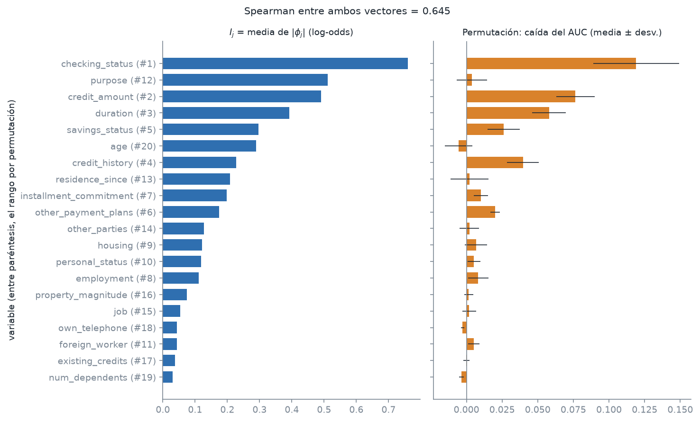

*Figura 7. Importancia por variable: media de |φ| (izquierda) y caída del AUC por permutación, media ± desviación (derecha). Entre paréntesis, el rango por permutación.*

### (d) Dos clientes

**Cliente aprobado** (posición 0 del conjunto de prueba; p(good) = 0.866, f(x) = 1.869):

| Variable y valor | φ (log-odds) | Efecto sobre el log-odds |
|---|---|---|
| `savings_status` = no known savings | +0.916 | aumenta |
| `checking_status` = 0<=X<200 | -0.410 | reduce |
| `credit_amount` = 2427 | +0.393 | aumenta |

**Cliente rechazado** (posición 1 del conjunto de prueba; p(good) = 0.087, f(x) = -2.349):

| Variable y valor | φ (log-odds) | Efecto sobre el log-odds |
|---|---|---|
| `duration` = 36 | -0.926 | reduce |
| `savings_status` = no known savings | +0.877 | aumenta |
| `other_payment_plans` = bank | -0.806 | reduce |

En el cliente aprobado, las tres mayores contribuciones son `savings_status` = no known savings (aumenta el log-odds en 0.916), `checking_status` = 0<=X<200 (reduce el log-odds en 0.410) y `credit_amount` = 2427 (aumenta el log-odds en 0.393); el log-odds final (1.869) queda por encima del valor base (1.431). En el cliente rechazado, las tres mayores contribuciones son `duration` = 36 (reduce el log-odds en 0.926), `savings_status` = no known savings (aumenta el log-odds en 0.877) y `other_payment_plans` = bank (reduce el log-odds en 0.806); el log-odds final (-2.349) queda por debajo del valor base (1.431). Los valores categóricos se muestran con su etiqueta original.

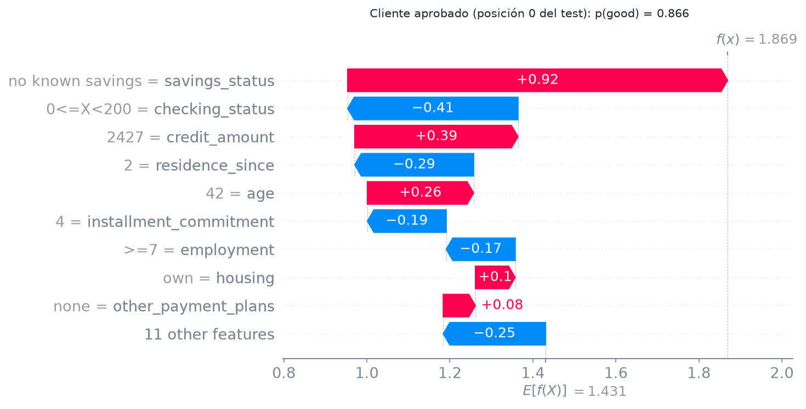

*Figura 8. Cascada SHAP del cliente aprobado (p > 0.8).*

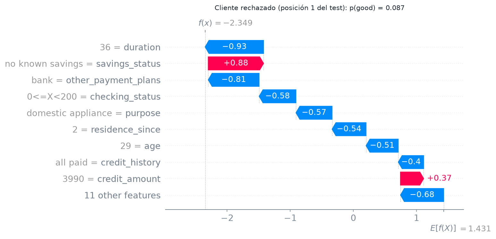

*Figura 9. Cascada SHAP del cliente rechazado (p < 0.2).*

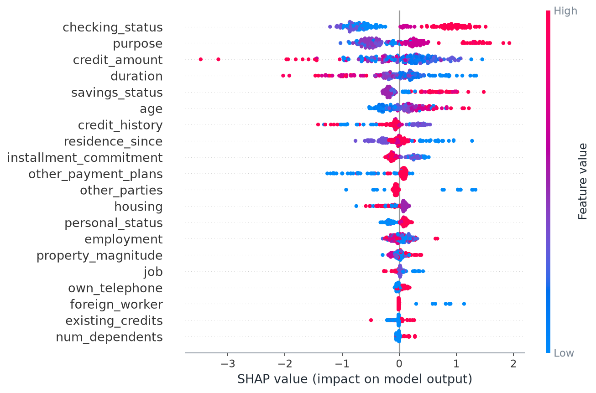

*Figura 10. Gráfico de enjambre SHAP global sobre el conjunto de prueba (el color de las categóricas corresponde a su código ordinal).*

En el enjambre, las variables ordenadas por I<sub>j</sub> son `checking_status`, `purpose` y `credit_amount`. Para las numéricas de mayor
importancia: en `credit_amount`, no hay una relación monótona clara entre el valor y la contribución (ρ = -0.11); en `duration`, un valor mayor se asocia con menor contribución (ρ = -0.81); en `age`, un valor mayor se asocia con mayor contribución (ρ = +0.81).

## Task 2.3 - Variable duplicada con ruido

La numérica con mayor I<sub>j</sub> es `credit_amount` (I<sub>j</sub> = 0.4908). Se creó `credit_amount_copy` = x + 0.05·σ·ε, con σ = 2822.7 (calculada en el conjunto
completo) y ε ~ N(0, 1) con semilla 42; la correlación entre la variable y su copia es 0.99878. El modelo se reentrenó con 21 variables
(exactitud 0.760, AUC 0.767) y se usaron las mismas filas de fondo.

| Configuración | mean\|φ_orig\| | mean\|φ_copia\| | mean\|φ_orig + φ_copia\| | % del original | corr(φ_orig, φ_copia) |
|---|---|---|---|---|---|
| interventional | 0.5126 | 0.4286 | 0.5455 | 54.5% | -0.29 |
| tree_path_dependent | 0.3760 | 0.3667 | 0.5301 | 50.6% | -0.07 |

I<sub>j</sub> de `credit_amount` en el modelo **sin** copia: 0.4908 (es otro modelo, por lo que no es exactamente comparable).

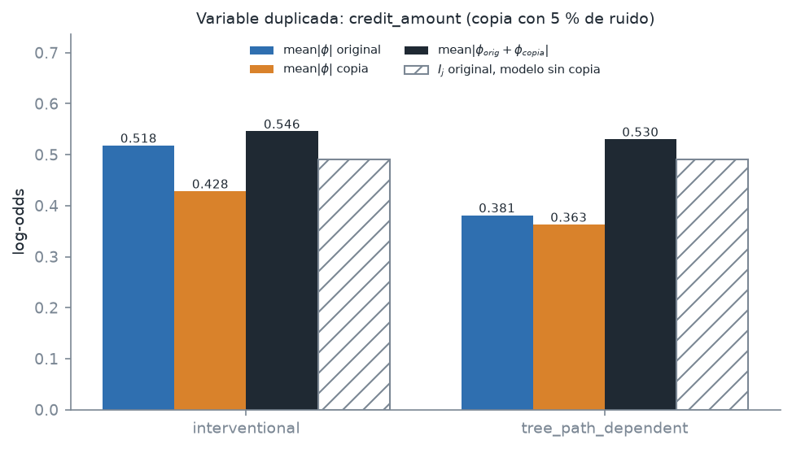

*Figura 11. Crédito repartido entre la variable y su copia, con ambos métodos de TreeSHAP.*

## Task 2.4 - KernelSHAP frente a TreeSHAP

KernelSHAP (`nsamples` = 2000) sobre las primeras 10 filas de prueba, con fondos anidados de k = 10, 50 y 100 filas; TreeSHAP interventional usa
**el mismo** fondo en cada caso. El MAE se promedia sobre 10 × 20 valores φ.

| k | MAE | Error máximo | KernelSHAP (s) | TreeSHAP (s) | KernelSHAP por instancia (s) | Evaluaciones |
|---|---|---|---|---|---|---|
| 10 | 0.0347 | 0.6239 | 0.29 | 0.0015 | 0.029 | 200,010 |
| 50 | 0.0416 | 0.8252 | 0.83 | 0.0066 | 0.083 | 1,000,010 |
| 100 | 0.0300 | 0.3683 | 1.48 | 0.0132 | 0.148 | 2,000,010 |

El conteo de evaluaciones supera en 10 (una por instancia, para f(x)) el producto nsamples·k·instancias. Con el mismo fondo, TreeSHAP es entre
113 y 197 veces más rápido que KernelSHAP (los tiempos dependen de la máquina y de la corrida).

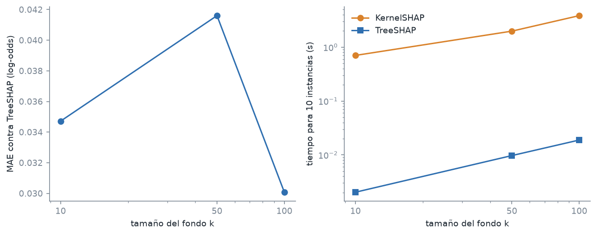

*Figura 12. MAE de KernelSHAP contra TreeSHAP y tiempos de cómputo según el tamaño del fondo.*

## Task 2.5 - Shapley exacto escrito a mano

Modelo con seis variables (`duration`, `credit_amount`, `installment_commitment`, `residence_since`, `age`, `existing_credits`), misma partición, semilla e hiperparámetros (exactitud 0.685, AUC 0.634). Con un fondo de
50 filas se enumeraron las 64 coaliciones con máscaras de bits y se evaluó v(S) = media<sub>b</sub> f(x<sub>S</sub>, b<sub>¬S</sub>) en una sola llamada al modelo; los
pesos son |S|!(n−|S|−1)!/n!. Resultados de las primeras 5 filas de prueba (log-odds):

| Cliente (test) | `duration` | `credit_amount` | `installment_commitment` | `residence_since` | `age` | `existing_credits` | Σφ | f(x) − v(∅) |
|---|---|---|---|---|---|---|---|---|
| 0 | -0.4652 | +0.3353 | -0.0531 | -0.1108 | +0.3497 | +0.1798 | +0.2356 | +0.2356 |
| 1 | -1.1706 | +0.0933 | -0.0414 | -0.1200 | -0.3243 | -0.0771 | -1.6400 | -1.6400 |
| 2 | +0.3207 | -1.4423 | +0.0317 | +0.0155 | +0.5182 | -0.0785 | -0.6348 | -0.6348 |
| 3 | +0.5520 | +0.6827 | -0.0529 | -0.1470 | +0.5080 | -0.1110 | +1.4318 | +1.4318 |
| 4 | +0.6726 | -1.5010 | +0.0291 | +0.0134 | +0.9341 | -0.0839 | +0.0643 | +0.0643 |

- Máximo error absoluto contra `TreeExplainer` interventional con el mismo fondo: **2.43e-08**.
- Eficiencia, máx. |Σφ − (v(N) − v(∅))|: **2.22e-16**; además v(N) coincide con f(x) (error 4.4e-16).
- Tiempo del cálculo propio para las 5 instancias: 0.013 s.

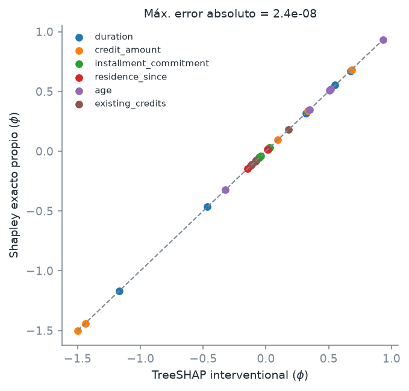

*Figura 13. Shapley exacto propio contra TreeSHAP interventional (30 valores).*

El error contra TreeSHAP (2.4e-08) es mucho mayor que el de la eficiencia del cálculo propio
(2.2e-16), lo que es coherente con que TreeSHAP acumule en precisión simple y el cálculo propio en float64.

## Task 2.6 - Análisis

### (a) Aditividad en log-odds frente a probabilidad (cliente rechazado)

Cliente de la posición 1: p(x) = 0.0871, f(x) = -2.3490, φ0 = 1.4307, σ(φ0) = 0.8070.

| Cantidad | Valor |
|---|---|
| Σ<sub>j</sub> φ<sub>j</sub> | -3.7798 |
| f(x) − φ0 | -3.7798 |
| p(x) − σ(φ0) | -0.7199 |
| Σ<sub>j</sub> [σ(φ0 + φ<sub>j</sub>) − σ(φ0)] | -0.7699 |
| [p(x) − σ(φ0)] − Σ<sub>j</sub> [σ(φ0 + φ<sub>j</sub>) − σ(φ0)] | +0.0500 |

Mayores efectos individuales en probabilidad:

| Variable | σ(φ0 + φ_j) − σ(φ0) |
|---|---|
| `duration` | -0.1835 |
| `other_payment_plans` | -0.1558 |
| `checking_status` | -0.1071 |
| `purpose` | -0.1046 |
| `savings_status` | +0.1025 |

La suma de los φ coincide con f(x) − φ0 porque la función explicada es f (el log-odds) y los valores de Shapley son aditivos en esa escala. La probabilidad
es σ(f), y σ no es lineal: σ(a + b) − σ(a) ≠ [σ(φ0 + φ_1) − σ(φ0)] + [σ(φ0 + φ_2) − σ(φ0)] porque cada término evalúa la pendiente de σ en
un punto distinto (φ0 + φ_j) y no en el punto final (f(x) = -2.349). Con estos números, la suma de efectos individuales (-0.7699) sobreestima la magnitud del
cambio real de probabilidad (-0.7199) en 0.0500.

### (b) Mayor desacuerdo entre las dos importancias: `age`

`age` ocupa el puesto 6 por I<sub>j</sub> (0.2886) y el 20 por permutación (-0.0054 ± 0.0096; diferencia de 14 puestos).
I<sub>j</sub> mide cuánto mueve la variable el log-odds de las predicciones (contribución media absoluta, sin mirar si acierta); la permutación mide cuánto
cae el AUC en el conjunto de prueba al romper la relación entre la variable y el resultado.

Evidencia calculada: sus mayores correlaciones de Spearman (entrenamiento) son `housing` (-0.31), `employment` (+0.31), `personal_status` (+0.27); el máximo en valor absoluto es 0.31, bajo, por lo que la correlación con otras variables no explica el desacuerdo.
La desviación de la permutación (0.0096) es al menos tan grande como el valor absoluto de su media (0.0054), así que su efecto sobre el AUC no se distingue de cero y la media es negativa (mezclar la variable no empeora el AUC).
Además, hacen falta 52 de 200 clientes (26.0%) para acumular la mitad de su Σ|φ|, de modo que su efecto está repartido y no concentrado en pocos clientes.
**Hipótesis** (no se probó con un experimento adicional): el modelo usa `age` (53 valores distintos, con lo que los árboles pueden ajustar con ella detalles del entrenamiento) sin que ese uso mejore el AUC en prueba. Con un
conjunto de prueba de 200 clientes y una sola semilla, esta explicación es tentativa.

### (c) Crédito entre la variable y su copia (tabla de 2.3)

En el modelo interventional, `credit_amount` recibe 0.5126 y la copia 0.4286 (54.5% para el original); con `tree_path_dependent`,
0.3760 y 0.3667 (50.6%). El axioma de simetría de Shapley pediría un reparto igual (50 %) si el modelo tratara las dos columnas de forma
simétrica, y el reparto observado se acerca más a ese 50 % con tree_path_dependent (desviación de 0.6 puntos frente a 4.5). No es exacto porque la simetría es una propiedad de la función
explicada y no del método: los árboles eligen en cada división una de las dos columnas casi idénticas, el ruido del 5 % rompe los empates y el f ajustado no es simétrico en ellas.
La correlación entre φ_orig y φ_copia es -0.29 (interventional) y -0.07 (`tree_path_dependent`).

La suma de ambas contribuciones (0.5455 y 0.5301) se compara con I<sub>j</sub> = 0.4908 del modelo sin copia
(+11.2 % y +8.0 %), mientras que cada columna por separado queda por debajo de esa suma. Con `interventional`, el
fondo rompe la dependencia entre columnas (evalúa combinaciones del original de un cliente con la copia de otro, que no ocurren en los datos); con `tree_path_dependent` sólo se usan las
proporciones de entrenamiento (`cover`) a lo largo de cada camino del árbol. Esta última **no** equivale a la esperanza condicional verdadera: sólo captura la dependencia que los
propios cortes del árbol reflejan y la ignora donde las divisiones no la expresan. Para una importancia real, esto significa que variables casi duplicadas se reparten el crédito (aquí, ninguna de las dos alcanza por sí sola la suma) y que la importancia
individual de cada una subestima la del concepto compartido; conviene sumar los grupos correlacionados, como la columna "suma" de la tabla.

### (d) Costo computacional

| k | Evaluaciones del modelo | Tiempo KernelSHAP (s) | Tiempo / evaluación (µs) | MAE |
|---|---|---|---|---|
| 10 | 200,010 | 0.29 | 1.46 | 0.0347 |
| 50 | 1,000,010 | 0.83 | 0.83 | 0.0416 |
| 100 | 2,000,010 | 1.48 | 0.74 | 0.0300 |

Tiempo por evaluación entre k = 50 y k = 100: 0.83 µs y 0.74 µs (diferencia de 11.2%); con k = 10 es 1.46 µs. El tiempo crece de forma aproximadamente lineal con nsamples·k (para k ≥ 50); el costo por evaluación más alto
con k = 10 sugiere un costo fijo por instancia que se amortiza al subir k. El MAE no disminuye de forma monótona con k (0.0347 → 0.0416 → 0.0300); con k = 100 es 13.5% menor que con k = 10.
Con 10 instancias y una sola corrida (el muestreo de KernelSHAP es aleatorio) este experimento no basta para afirmar que más fondo reduzca el error de forma sistemática.

Con un tiempo de `decision_function` sobre 100 filas de 0.653 ms (mediana de 30 repeticiones), el Shapley exacto con 20 variables requiere
2<sup>20</sup> coaliciones × t(100) ≈ **685 s (0.19 h) por instancia**, frente a 0.148 s de KernelSHAP con k = 100
(4613 veces menos). Con 60 variables y 1 µs por evaluación, 2<sup>60</sup> × 10<sup>−6</sup> s ≈ **3.653e+04 años** por instancia, por lo que el cálculo exacto es inviable
y se necesitan aproximaciones (KernelSHAP) o estructura del modelo (TreeSHAP).

**Prompt utilizado**

Usa German Credit con `fetch_openml("credit-g", version=1)`, codifica `good`=1 y `bad`=0, pasa las 13 categóricas por un `OrdinalEncoder` (tratando los códigos como numéricos) y divide 80/20 estratificado con semilla 42. Entrena un `GradientBoostingClassifier` con 200 árboles y profundidad 3. Para SHAP usa `TreeExplainer` con `feature_perturbation="interventional"` y `model_output="raw"`, de modo que la salida explicada sea el log-odds de `decision_function`, con un fondo de 100 filas del entrenamiento elegidas con la semilla. Verifica la eficiencia y que el valor base sea el promedio del log-odds en el fondo, compara la importancia media |φ| con `permutation_importance` (AUC, 10 repeticiones) usando Spearman, y en KernelSHAP usa exactamente el mismo fondo que en TreeSHAP para que el error compare lo mismo. La fórmula de Shapley del 2.5 la quiero escrita a mano: enumera las 64 coaliciones con máscaras de bits, evalúalas todas en una sola llamada al modelo y usa los pesos |S|!(n−|S|−1)!/n!. Guarda los números en `outputs/task2/results.json` e imprime una tabla de verificaciones OK/FALLO con tolerancias.

**Por qué funcionó este prompt**

Fijamos los detalles que cambian los números en lugar de pedir simplemente "calcula SHAP". Con `model_output="raw"` SHAP explica el log-odds; sin eso explicaría otra salida y la eficiencia en log-odds no cerraría. Nombrar `interventional` frente a `tree_path_dependent` evitó que la librería escogiera una de las dos por defecto sin que lo supiéramos. Usar el mismo fondo en KernelSHAP y en TreeSHAP hizo que el MAE midiera sólo la aproximación y no un cambio de referencia. Pedir las 64 coaliciones vectorizadas en una sola llamada permitió que el cálculo exacto corriera en segundos, y las verificaciones automáticas con tolerancias detectaron errores antes de escribir el informe.

<!-- INFORME_TASK2:FIN -->

<!-- INFORME_TASK3:INICIO (generado por scripts/run_task3.py; no editar a mano) -->

# Task 3

## Configuración

- Salida explicada: P(good) del mismo `GradientBoostingClassifier` y los mismos tres clientes del Task 2 (`credit.build_base` y `select_clients`).
- Semilla aleatoria: **42**. Muestras por explicación: N = 5000; variables conservadas: K = 5; λ = 1;
  σ_rel = 0.75 con d' = 20, es decir σ = σ_rel·√d' = 3.3541.
- Variable ausente: z'_j ~ Bernoulli(0.5) de forma independiente por muestra y variable; con z'_j = 1 se conserva el valor del cliente y
  con z'_j = 0 se toma un valor al azar de la columna j del conjunto de entrenamiento. Peso π = exp(−D²/σ²), con D² igual al número de variables ausentes.
- Ajuste: regresión ridge ponderada en forma cerrada con `np.linalg.solve`; el intercepto **no se penaliza**. Se ajustan las 20 variables, se
  conservan las K de mayor |w| y se reajusta sólo con ellas; R²_w se calcula sobre ese reajuste con las mismas muestras y pesos.
- Versiones: scikit-learn 1.9.1, NumPy 2.5.2, pandas 3.0.6, Python 3.12.13.

## Task 3.1 - LIME desde cero

**Cliente aprobado** (posición 0 del conjunto de prueba; p(good) = 0.866; intercepto = 0.669; R²_w = 0.172; N_ef = 4808.4):

| Variable | Valor del cliente | Coeficiente |
|---|---|---|
| `savings_status` | no known savings | +0.141 |
| `credit_amount` | 2427 | +0.074 |
| `checking_status` | 0<=X<200 | -0.063 |
| `residence_since` | 2 | -0.038 |
| `duration` | 18 | +0.033 |


**Cliente rechazado** (posición 1 del conjunto de prueba; p(good) = 0.087; intercepto = 0.551; R²_w = 0.227; N_ef = 4808.4):

| Variable | Valor del cliente | Coeficiente |
|---|---|---|
| `savings_status` | no known savings | +0.142 |
| `other_payment_plans` | bank | -0.132 |
| `checking_status` | 0<=X<200 | -0.112 |
| `duration` | 36 | -0.106 |
| `age` | 29 | -0.102 |


**Cliente dudoso** (posición 87 del conjunto de prueba; p(good) = 0.504; intercepto = 0.635; R²_w = 0.279; N_ef = 4808.4):

| Variable | Valor del cliente | Coeficiente |
|---|---|---|
| `checking_status` | no checking | +0.241 |
| `duration` | 36 | -0.154 |
| `credit_amount` | 909 | -0.106 |
| `purpose` | new car | -0.074 |
| `age` | 36 | +0.044 |


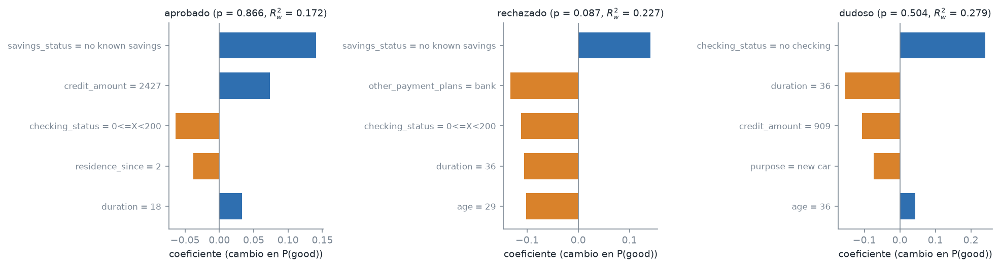

*Figura 14. Coeficientes LIME (top-5) de los tres clientes; R²_w del reajuste en el título de cada panel.*

En el cliente rechazado (p = 0.087), `other_payment_plans`, `checking_status`, `duration` y `age` tienen coeficiente negativo, es decir, conservar su valor en lugar de sustituirlo por uno de entrenamiento baja P(good) en la aproximación local; el de mayor magnitud es `other_payment_plans` = bank (-0.132). En sentido contrario, `savings_status` = no known savings (+0.142) tiene coeficiente positivo. R²_w va de 0.172 (cliente aprobado) a 0.279 (cliente dudoso): en los tres clientes el modelo lineal con 5 variables explica menos de la mitad de la varianza ponderada de P(good), de modo que los coeficientes describen sólo una parte del comportamiento local del modelo. Variables presentes en el top-5 de dos clientes: aprobado y rechazado: `checking_status`, `duration` y `savings_status`; aprobado y dudoso: `checking_status`, `credit_amount` y `duration`; rechazado y dudoso: `age`, `checking_status` y `duration`.

## Task 3.2 - Estabilidad

Cliente rechazado (posición 1); para cada combinación de N y σ_rel se corrieron 20 explicaciones con las semillas
0 a 19 y se promedió el Jaccard del top-5 sobre los 190 pares.

**Jaccard medio** (filas N, columnas σ_rel):

| N \ σ_rel | 0.5 | 0.75 | 1.5 |
|---|---|---|---|
| 500 | 0.6981 | 0.6992 | 0.7216 |
| 2000 | 0.7689 | 0.7872 | 0.8043 |
| 5000 | 0.9105 | 0.9368 | 0.9368 |

**N_ef medio** (filas N, columnas σ_rel):

| N \ σ_rel | 0.5 | 0.75 | 1.5 |
|---|---|---|---|
| 500 | 407.9 | 480.3 | 498.7 |
| 2000 | 1637.9 | 1922.0 | 1995.0 |
| 5000 | 4098.9 | 4805.9 | 4987.6 |

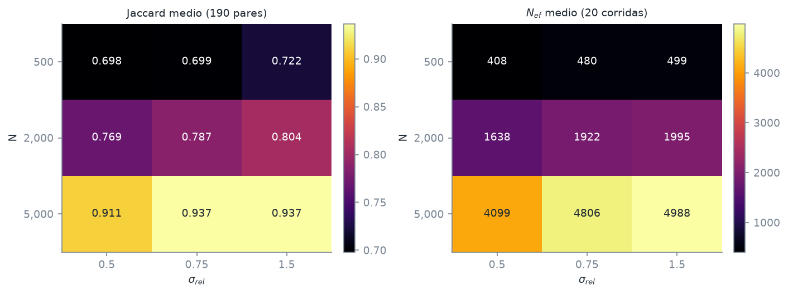

*Figura 15. Jaccard medio y tamaño efectivo de muestra N_ef según N y σ_rel (cliente rechazado).*

El Jaccard medio crece con N en las tres anchuras (por ejemplo, con σ_rel = 0.75 pasa de 0.699 con N = 500 a 0.937 con N = 5000); con N fijo no disminuye al aumentar σ_rel; el valor más alto es 0.937 (N = 5000, σ_rel = 1.5) y el más bajo 0.698 (N = 500, σ_rel = 0.5). N_ef equivale a una fracción de N que casi no cambia con N (variación máxima de 0.4% de N dentro de cada σ_rel); promedia 81.8% de N con σ_rel = 0.5, 96.1% con 0.75 y 99.8% con 1.5, de modo que un kernel más ancho reparte el peso entre más muestras.

## Task 3.3 - Comparación de LIME con SHAP

### (a) Ranking y coincidencia de variables

Spearman entre |w| de LIME (primer ajuste, 20 variables, misma semilla que en 3.1) y |φ| de TreeSHAP interventional del Task 2.2
(mismo modelo y mismo fondo de 100 filas), y coincidencia entre las tres variables principales de cada método. Como LIME explica P(good)
y SHAP el log-odds, se agrega como control la correlación con |φ| calculado por TreeSHAP sobre la probabilidad.

| Cliente | p(good) | Spearman \|w\| vs \|φ\| | Spearman vs \|φ\| (probabilidad) | Top-3 LIME | Top-3 SHAP | Coincidencia |
|---|---|---|---|---|---|---|
| aprobado | 0.866 | 0.723 | 0.851 | `savings_status`, `credit_amount` y `checking_status` | `savings_status`, `checking_status` y `credit_amount` | 3/3 |
| rechazado | 0.087 | 0.952 | 0.952 | `savings_status`, `other_payment_plans` y `checking_status` | `duration`, `savings_status` y `other_payment_plans` | 2/3 |
| dudoso | 0.504 | 0.869 | 0.853 | `checking_status`, `duration` y `credit_amount` | `checking_status`, `duration` y `credit_amount` | 3/3 |

La correlación va de 0.723 (cliente aprobado) a 0.952 (cliente rechazado): ambos métodos ordenan las variables de forma parecida.
El top-3 coincide por completo en aprobado y dudoso. Difiere en rechazado (2/3: LIME pone `checking_status` y SHAP `duration`).

### (b) Fidelidad según el número de variables (cliente rechazado)

| K | R²_w | Variables añadidas respecto del K anterior |
|---|---|---|
| 3 | 0.158 | `savings_status`, `other_payment_plans` y `checking_status` |
| 5 | 0.227 | `duration` y `age` |
| 10 | 0.293 | `residence_since`, `purpose`, `credit_history`, `credit_amount` y `property_magnitude` |
| 20 | 0.301 | `installment_commitment`, `employment`, `personal_status`, `job`, `foreign_worker`, `housing`, `other_parties`, `own_telephone`, `num_dependents` y `existing_credits` |

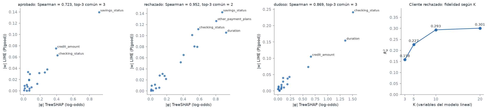

*Figura 16. |w| de LIME contra |φ| de TreeSHAP por cliente y R²_w del cliente rechazado según K.*

R²_w crece con K (+0.068 de K = 3 a 5; +0.066 de K = 5 a 10; +0.007 de K = 10 a 20), pero incluso con las 20 variables el modelo lineal en z' explica sólo 30.1% de la varianza
ponderada de P(good). El límite no lo pone K sino la forma del modelo sustituto: un modelo aditivo en presencia/ausencia no puede
representar las interacciones del modelo de árboles (ver 3.5(b)).

## Task 3.4 - Explicaciones contrafactuales

Cliente rechazado (posición 1, P(good) = 0.087). Se generaron 20,000 candidatos; cada uno
cambia un número uniforme de 1 a 3 variables accionables (`duration`, `credit_amount`, `installment_commitment`, `checking_status` y `savings_status`) elegidas al azar, con valores tomados
al azar de los valores observados en el entrenamiento distintos del original (con su frecuencia). Las inmutables (`age`, `personal_status` y `foreign_worker`)
y el resto de variables no se modifican. Un candidato es válido si P(good) ≥ θ = 0.5. Escalas de la distancia: `duration` = 6 (MAD), `credit_amount` = 1057.5 (MAD), `installment_commitment` = 1 (MAD);
las categóricas cuentan 1 si cambian.

| # | Variables modificadas | Original → nuevo | Distancia | P(good) |
|---|---|---|---|---|
| 1 | `checking_status`, `duration` y `credit_amount` | 0<=X<200 → no checking; 36 → 30; 3990 → 3780 | 2.199 | 0.530 |
| 2 | `duration`, `credit_amount` y `installment_commitment` | 36 → 30; 3990 → 3594; 3 → 1 | 3.374 | 0.555 |
| 3 | `checking_status`, `duration` y `installment_commitment` | 0<=X<200 → no checking; 36 → 30; 3 → 1 | 4.000 | 0.519 |

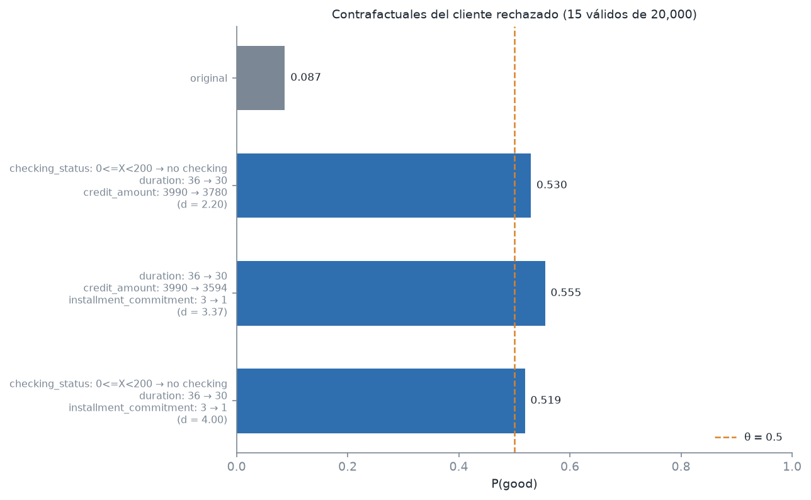

*Figura 17. P(good) del cliente rechazado y de los tres contrafactuales seleccionados (línea: umbral θ).*

| Métrica | Valor |
|---|---|
| Validez (candidatos válidos / total) | **0.075%** (15 de 20,000) |
| Proximidad promedio (3 seleccionados) | **3.191** (todos los válidos: 6.050) |
| Dispersión: variables cambiadas en promedio (3 seleccionados) | **3.0** (todos los válidos: 3.0) |
| Máximo P(good) entre todos los candidatos | 0.619 |

Válidos según el número de variables cambiadas: 1 variable: 0 de 6,729; 2 variables: 0 de 6,648; 3 variables: 15 de 6,623. Hubo candidatos válidos con el máximo de 3 variables, por lo que no fue necesario subirlo a 5. Ningún cambio de una o dos variables basta para pasar el umbral, de modo que
el rechazo no depende de una sola variable accionable.

## Task 3.5 - Análisis

### (a) Relación entre estabilidad y tamaño efectivo

En las nueve celdas del Task 3.2 el Jaccard medio aumenta con N_ef (Spearman = 0.996, p = 1.5e-08):
la estabilidad depende de cuántas muestras pesan de verdad en el ajuste, más que de N o de σ_rel por separado. Para σ_rel = 0.75, N_ef es
96.1% de N, así que N_ef y N son casi proporcionales.

**Estimación.** El error de los coeficientes de la regresión ponderada disminuye como 1/√N_ef, y el top-5 cambia cuando ese error intercambia
la variable K-ésima con la siguiente; por eso se modeló 1 − J = a·N_ef^(−b) y se ajustó con los dos puntos de la tabla que encierran el objetivo
(N = 2000 y N = 5000), es decir, una interpolación en escala log-log y no una extrapolación fuera del rango medido. Resultado:
b = 1.33, N_ef necesario = 3398 y **N ≈ 3600** (N_ef / 0.961, redondeado hacia arriba a un múltiplo de 100).

**Verificación.** Una corrida adicional con N = 3600, σ_rel = 0.75 y las mismas 20 semillas dio un Jaccard medio de
**0.907** (N_ef = 3460), que alcanza el objetivo de 0.9.
La estimación se confirma. El valor tiene su propio ruido: con 20 corridas el Jaccard medio
de una celda varía de una ejecución a otra, por lo que la cifra debe leerse como orden de magnitud (unas 3600 muestras) y no como un umbral exacto.

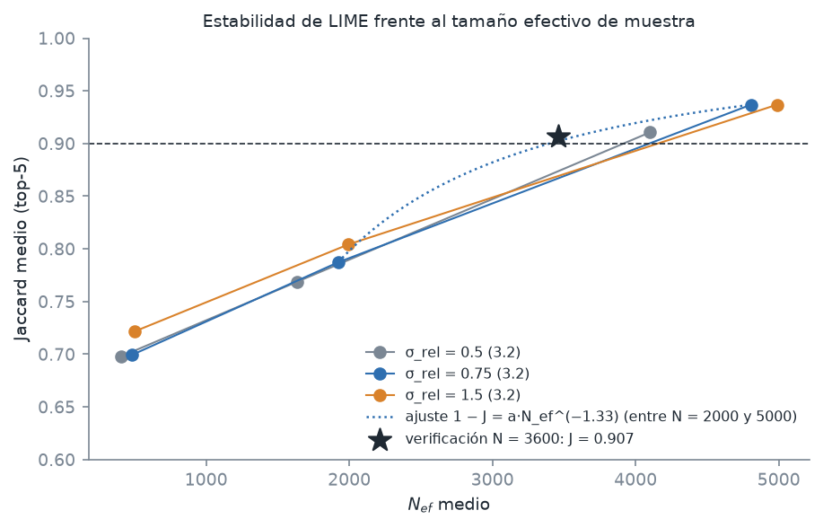

*Figura 18. Jaccard medio contra N_ef en las nueve celdas del 3.2, curva ajustada y corrida de verificación.*

### (b) Desacuerdo entre LIME y SHAP

Se buscó la mayor diferencia de puesto entre el ranking de |w| (LIME) y el de |φ| (SHAP) en los tres clientes: **cliente aprobado,
variable `duration`** (puesto 5 en LIME y 14 en SHAP). Además, los signos son opuestos: w = +0.0333
(P(good)) y φ = -0.0549 (log-odds).

**Hipótesis:** el efecto de `duration` = 18 depende de los valores de las demás variables (interacción). SHAP promedia su
contribución sobre coaliciones de todos los tamaños con el mismo peso, mientras que LIME concentra sus muestras en coaliciones con la mitad de las
variables presentes y explica la probabilidad, no el log-odds. Se probaron las tres explicaciones posibles:

1. **Localidad.** Con σ_rel ∈ {0.25, 0.5, 0.75, 1.5, 3} y 10 semillas por valor, el coeficiente medio de LIME fue
   +0.0193, +0.0242, +0.0224, +0.0214, +0.0211 (positivo en 50 de 50 corridas) y su puesto medio
   6.9, 7.9, 8.2, 8.3, 8.3. Reducir el kernel **no** acerca LIME a SHAP: el signo no cambia, de modo que la
   discrepancia no se debe a la localidad.
2. **Relación no lineal.** Al variar sólo `duration` en el cliente (panel izquierdo de la figura siguiente), P(good) es una función escalonada y
   no monótona, que va de 0.950 a 0.451. Con su valor actual (18) P(good) = 0.866,
   por encima del promedio al sustituirlo por los valores de entrenamiento (0.821); 44.9% de esos valores dan una
   probabilidad menor. La no linealidad existe, pero con las demás variables del cliente fijas el valor actual favorece la aprobación, lo
   que coincide con el signo de LIME y no con el de SHAP.
3. **Interacción.** Se midió el efecto medio de conservar `duration` = 18 según cuántas de las otras 19 variables conservan
   el valor del cliente (400 coaliciones por tamaño, el resto tomado del fondo de SHAP). En log-odds el efecto pasa de
   -0.253 (ninguna otra variable del cliente) a +0.188 (las 19) y cambia de signo a partir de 13 variables.
   El promedio uniforme sobre los tamaños, que es lo que hace Shapley, da -0.0546, prácticamente igual a
   φ = -0.0549, lo que valida la prueba. En los tamaños donde se concentra el muestreo de LIME (8 a 11 variables) el efecto en
   log-odds es -0.080, -0.068, -0.024, -0.020, y en probabilidad el promedio sobre tamaños es +0.0066.
   Con TreeSHAP sobre la probabilidad, φ = +0.0119 (puesto 10), del mismo signo que LIME.

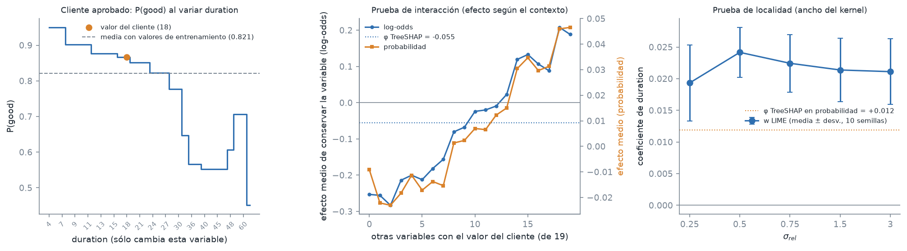

*Figura 19. Cliente aprobado, variable duration: P(good) al variar sólo esa variable, efecto según el número de variables del cliente presentes y coeficiente de LIME según σ_rel.*

**Conclusión:** la discrepancia se debe a una **interacción**: el efecto de `duration` cambia de signo según el contexto, y cada método
promedia contextos distintos (SHAP pondera por igual las coaliciones pequeñas, donde el efecto es negativo). La escala de salida la acentúa,
porque la misma interacción promediada en probabilidad da un φ positivo. No se debe a la localidad, y la no linealidad de `duration`
por sí sola no explica el cambio de signo.

### (c) Fidelidad y comprensibilidad

Con la tabla de R²_w del 3.3(b) (K = 3: 0.158, K = 5: 0.227, K = 10: 0.293, K = 20: 0.301) se eligió **K = 10**, el menor K que alcanza el
90% de la fidelidad obtenida con las 20 variables (97.6%). A partir de ahí, duplicar las variables sólo agrega
+0.007 de R²_w y vuelve la explicación más difícil de leer; por debajo, con K = 5, se pierde
0.066 de R²_w. La comprensibilidad favorece pocos términos (una persona puede seguir unas 5 a 7 razones), y la
fidelidad favorece más términos sólo mientras el aumento de R²_w sea apreciable, que aquí se agota en K = 10.

Para una decisión de crédito se exigiría **R²_w ≥ 0.8**: la explicación se usa para justificar un rechazo ante el cliente y el regulador,
así que debe reproducir la mayor parte del comportamiento local del modelo; con una fidelidad menor, una razón dada podría no ser la que
realmente movió la decisión. **Ningún K la alcanza** (el máximo es 0.301). En ese caso no se entregaría la explicación de LIME como justificación.
Se usaría SHAP, cuya eficiencia se cumple con error de 1e-7 (Task 2.2), o el contrafactual del 3.4, cuya P(good) la calcula el propio modelo.
Para LIME, se podría intentar un sustituto que incluya interacciones (3.5(b) muestra que son la causa de la baja fidelidad) y reportar siempre R²_w junto a los coeficientes.

### (d) SHAP frente a contrafactuales

| Variable (top-3 \|φ\|) | Valor | φ | Tipo | ¿En contrafactuales? | Mejor cambio único | P(good) con ese cambio | Costo |
|---|---|---|---|---|---|---|---|
| `duration` | 36 | -0.926 | accionable | sí | 27 | 0.293 | 1.50 |
| `savings_status` | no known savings | +0.877 | accionable | no | >=1000 | 0.093 | 1.00 |
| `other_payment_plans` | bank | -0.806 | no accionable | no | none | 0.210 | 1.00 |

Los contrafactuales cambian `checking_status`, `credit_amount`, `duration` y `installment_commitment`. Del top-3 de |φ| sólo aparece `duration`.
`savings_status` (φ = +0.877) es accionable, pero su φ es positivo: su valor actual ya empuja hacia la aprobación; cambiarla nunca ayuda lo suficiente: el mejor valor (>=1000) da P(good) = 0.093 (el promedio de sus valores, 0.044), y de 7,921 candidatos que la cambian, 0 son válidos. Su efecto por cambio es pequeño o contrario. `other_payment_plans` (φ = -0.806) no es accionable en este ejercicio, así que la búsqueda nunca la modifica. Aunque se pudiera, el mejor valor (none) sólo lleva P(good) de 0.087 a 0.210 con costo 1, lejos de θ = 0.5. A la vez, los contrafactuales usan variables con |φ| bajo en este cliente (`checking_status`, `credit_amount` y `installment_commitment`) porque son baratas en la distancia y su
combinación cruza el umbral.

SHAP responde **"¿cuánto aportó cada variable a llevar el puntaje desde el promedio del fondo hasta el de este cliente?"**: reparte la
diferencia f(x) − φ0 entre las variables, sean o no modificables. El contrafactual responde **"¿qué cambio mínimo y factible haría que el
modelo aprobara la solicitud?"**: busca la frontera de decisión más cercana respetando las restricciones de accionabilidad. Una variable puede
ser la principal razón del puntaje y no aparecer en ningún contrafactual, si es inmutable o si cambiarla no alcanza el umbral.

**Prompt utilizado**

*3.1 y 3.2:* Pendiente (lo completa quien implementó esos incisos).

*3.3 a 3.5:* Con el enunciado del Laboratorio 10 y el repositorio, que ya tiene implementados los Tasks 1, 2, 3.1 y 3.2, implementa lo que falta del
Task 3 siguiendo la misma estructura (`task3.py` para los cálculos, `viz_task3.py`, `console_task3.py` y `report_task3.py`). En 3.3 compara |w| del
primer ajuste de LIME (20 variables, misma semilla) con |φ| de TreeSHAP interventional del Task 2.2 y calcula R²_w con K ∈ {3, 5, 10, 20} sobre las
mismas muestras. En 3.4 escribe la búsqueda de contrafactuales con NumPy: 20 000 candidatos que cambian de 1 a 3 variables accionables con
valores observados en el entrenamiento, distancia con MAD (o desviación absoluta media si la MAD es 0) y selección codiciosa de tres con
conjuntos de variables distintos. En 3.5 no escribas conclusiones sin datos: estima el N para un Jaccard de 0.9 a partir de la tabla del 3.2
y verifícalo con una corrida nueva, y prueba la causa del mayor desacuerdo LIME-SHAP con experimentos (ancho del kernel, P(good) al variar
una sola variable y efecto según el tamaño de la coalición). Agrega verificaciones numéricas con tolerancia a la consola.

**Por qué funcionó este prompt**

Dar el enunciado completo y pedir que se siguiera la estructura existente fijó las fórmulas, los parámetros y los nombres, y permitió
reutilizar el modelo, los clientes y el LIME del 3.1 sin reimplementarlos. Pedir que cada conclusión del 3.5 saliera de un experimento evitó
respuestas genéricas: la prueba de interacción se validó a sí misma porque su promedio sobre tamaños reproduce el φ de TreeSHAP, y la
estimación de N se comprobó con una corrida que no se usó para ajustarla.

<!-- INFORME_TASK3:FIN -->

<!-- INFORME_TASK4:INICIO (generado por scripts/run_task4.py; no editar a mano) -->

# Task 4

## Configuración

- Modelo y entrada: ResNet-18 (`IMAGENET1K_V1`) y las mismas tres imágenes del Task 1; clase de mayor probabilidad de cada imagen.
- Mapa: Grad-CAM del Task 1.2 (224×224, normalizado). Los píxeles se ordenan de mayor a menor valor del mapa; los empates (celdas con valor 0)
  conservan el orden de barrido.
- Deletion y insertion: P = 20 pasos, 10 órdenes aleatorios (semillas 42 a 51); gris medio = 0.5 (RGB 128);
  desenfoque gaussiano con σ = 10 píxeles por canal. Las imágenes se construyen en [0, 1] y se normalizan con la media y la desviación de ImageNet
  justo antes del modelo. AUC = (1/P) Σ_(k=1..P) c_k.
- Cascada: `reset_parameters` de PyTorch sobre cada Conv2d, Linear y BatchNorm2d de la capa (en BatchNorm también reinicia las estadísticas),
  acumulando `fc`, `layer4`, `layer3`, `layer2`, `layer1`, `conv1`; semilla 42. Mapa de 7×7 (Grad-CAM con ReLU, sin interpolar) de la clase original.
- Semilla aleatoria: **42**. Versiones: torch 2.14.1+cpu, torchvision 0.29.1+cpu, Python 3.12.13.

## Task 4.1 - Deletion e insertion

**Imagen (a)**, clase `golden retriever` (p = 0.9948; con la imagen toda en gris p = 0.0004; desenfocada p = 0.0048):

| Métrica | Grad-CAM | Azar (media ± desv., 10 órdenes) | Diferencia | Desviaciones a favor del mapa |
|---|---|---|---|---|
| AUC_del (menor es mejor) | 0.3346 | 0.1308 ± 0.0181 | +0.2038 | -11.3 |
| AUC_ins (mayor es mejor) | 0.8053 | 0.2828 ± 0.0193 | +0.5225 | +27.1 |


**Imagen (b)**, clase `Chihuahua` (p = 0.4449; con la imagen toda en gris p = 0.0003; desenfocada p = 0.0001):

| Métrica | Grad-CAM | Azar (media ± desv., 10 órdenes) | Diferencia | Desviaciones a favor del mapa |
|---|---|---|---|---|
| AUC_del (menor es mejor) | 0.0016 | 0.0025 ± 0.0018 | -0.0009 | +0.5 |
| AUC_ins (mayor es mejor) | 0.7579 | 0.0754 ± 0.0153 | +0.6825 | +44.7 |


**Imagen (c)**, clase `trimaran` (p = 0.2054; con la imagen toda en gris p = 0.0012; desenfocada p = 0.0009):

| Métrica | Grad-CAM | Azar (media ± desv., 10 órdenes) | Diferencia | Desviaciones a favor del mapa |
|---|---|---|---|---|
| AUC_del (menor es mejor) | 0.0074 | 0.0014 ± 0.0014 | +0.0060 | -4.3 |
| AUC_ins (mayor es mejor) | 0.0984 | 0.0145 ± 0.0008 | +0.0839 | +106.6 |


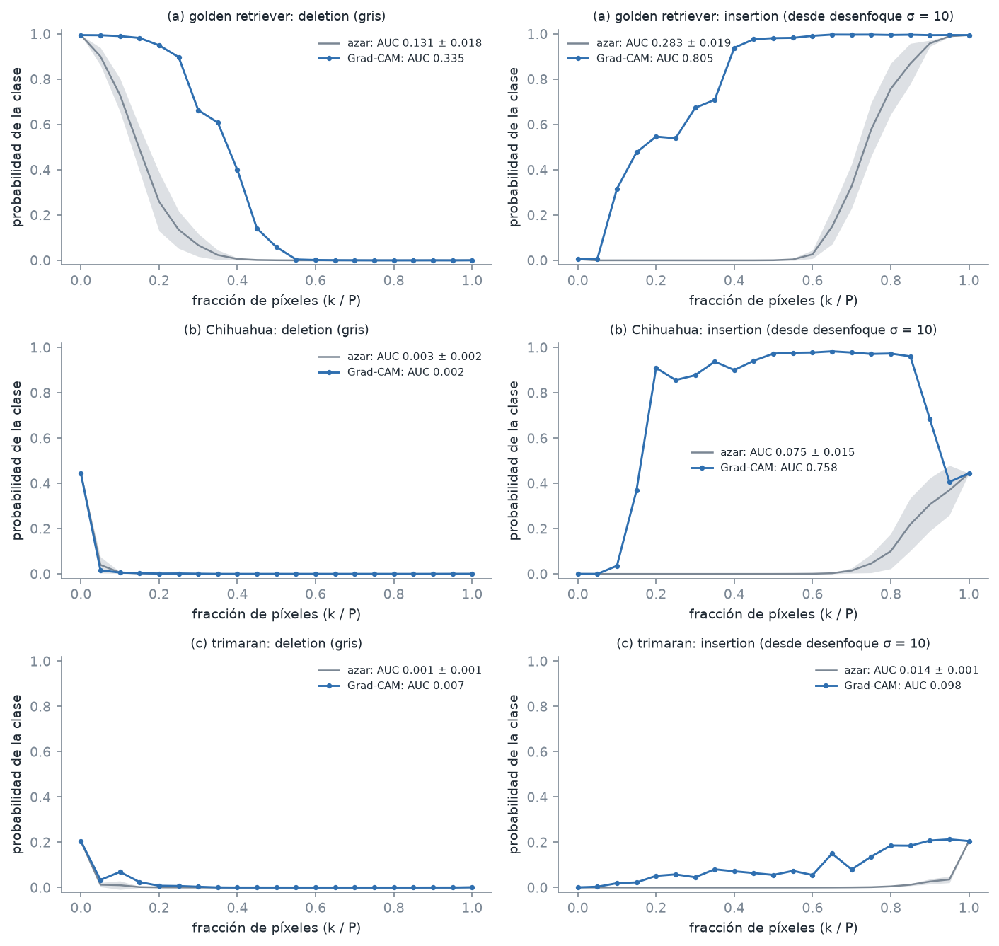

*Figura 20. Curvas de deletion (gris) e insertion (desde la imagen desenfocada) con el orden de Grad-CAM y con 10 órdenes aleatorios (media ± desviación).*

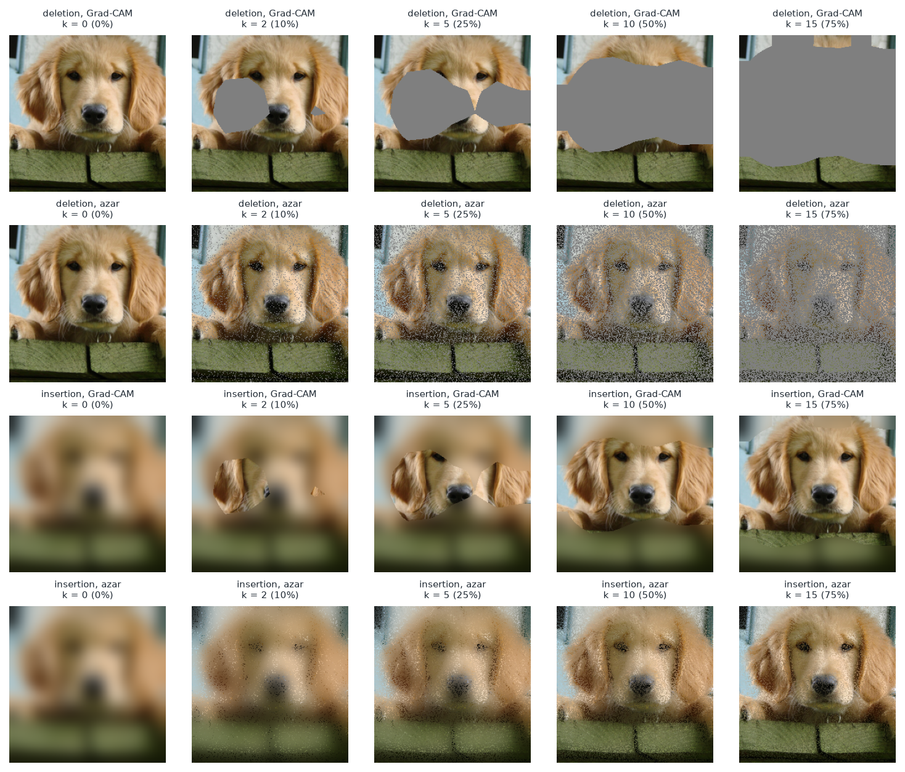

*Figura 21. Imagen (a): pasos de deletion e insertion con el orden de Grad-CAM y con un orden aleatorio.*

## Task 4.2 - Aleatorización de parámetros en cascada

Spearman entre el mapa de 7×7 original y el de cada etapa (entre paréntesis, el mismo cálculo sobre el mapa antes de ReLU, que no tiene empates en cero):

| Etapa | Capas reinicializadas | (a) golden retriever | (b) Chihuahua | (c) trimaran |
|---|---|---|---|---|
| 1 | `fc` | +0.389 (+0.390) | -0.214 (-0.442) | +0.448 (+0.237) |
| 2 | `fc`, `layer4` | -0.151 (-0.152) | -0.483 (-0.132) | -0.306 (-0.452) |
| 3 | `fc`, `layer4`, `layer3` | +0.233 (+0.233) | -0.242 (-0.199) | -0.018 (+0.043) |
| 4 | `fc`, `layer4`, `layer3`, `layer2` | -0.012 (-0.127) | -0.128 (-0.193) | -0.032 (-0.029) |
| 5 | `fc`, `layer4`, `layer3`, `layer2`, `layer1` | -0.104 (-0.088) | -0.294 (-0.027) | -0.049 (+0.024) |
| 6 | `fc`, `layer4`, `layer3`, `layer2`, `layer1`, `conv1` | +0.157 (+0.223) | -0.233 (+0.032) | -0.232 (-0.229) |

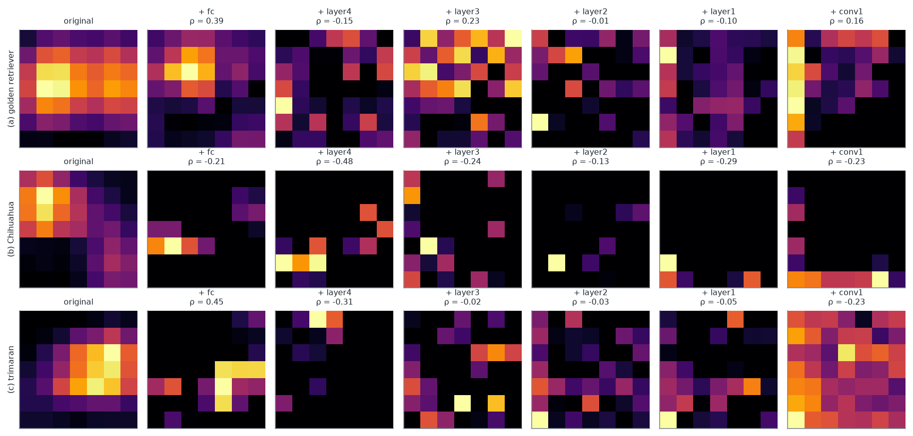

*Figura 22. Mapas de 7×7 de la clase original en cada etapa de la cascada (cada mapa escalado a su máximo) y su Spearman con el original.*

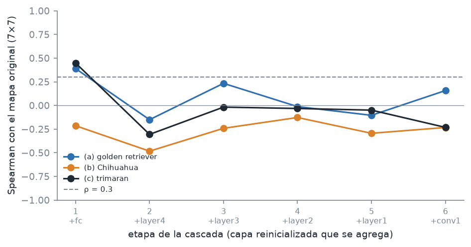

*Figura 23. Spearman con el mapa original en cada etapa de la cascada.*

## Task 4.3 - Análisis

### (a) Validación contra el azar

Con el criterio de 2 desviaciones estándar: en **insertion** Grad-CAM supera al azar en las tres imágenes
((a) 27.1, (b) 44.7, (c) 106.6 desviaciones estándar). En **deletion** con gris
no se distingue del azar en (b) (+0.5); queda **por debajo** del azar en (a) (-11.3) y (c) (-4.3).

**Forma de las curvas.** El mapa de 224×224 es la interpolación bilineal de un mapa de 7×7, así que tiene sólo 49 grados de libertad: cada
paso cambia 2509 píxeles (unas 2.5 celdas de 32×32) y el orden de Grad-CAM recorre bloques contiguos celda por celda.
En (a), el primer paso con el orden del mapa toca 4 de las 49 celdas, mientras que un orden aleatorio toca las 49 desde el primer paso. Por eso la
curva del mapa tiene mesetas y saltos: la probabilidad se mantiene por encima del 90 % de la inicial hasta el paso 5 (25% de los píxeles),
cae a la mitad en el paso 8 y el salto más grande (0.259) ocurre en el paso 9, cuando se borran
las celdas que cubren el animal. Con órdenes aleatorios la probabilidad decae de forma suave desde el primer paso (0.995 → 0.901) y cae a la mitad en el paso
3 a 4: los píxeles grises dispersos funcionan como ruido sobre toda la imagen y destruyen la textura que usa la red, aunque no borren ninguna región completa.
Por eso el azar resulta más "eficaz" en deletion que el mapa. En insertion ocurre lo contrario: unos pocos píxeles nítidos dispersos sobre la imagen desenfocada no
reconstruyen nada (la curva aleatoria de (a) sigue en 0.000 a la mitad de los pasos), mientras que el mapa inserta regiones enteras del objeto
(0.316 en el paso 2). En (b) y (c) la probabilidad inicial ya es baja (0.445 y 0.205) y cualquier orden la lleva casi a cero en el primer paso, de modo que AUC_del queda dominada por ese piso y discrimina poco.

**Efecto de los parches grises (imagen (a)).** Se repitió deletion reemplazando los píxeles por los de la imagen desenfocada en lugar de gris:

| Referencia | AUC_del Grad-CAM | AUC_del azar (media ± desv.) | Desviaciones a favor del mapa |
|---|---|---|---|
| Gris | 0.3346 | 0.1308 ± 0.0181 | -11.3 |
| Desenfocada (σ = 10) | 0.3413 | 0.2376 ± 0.0211 | -4.9 |

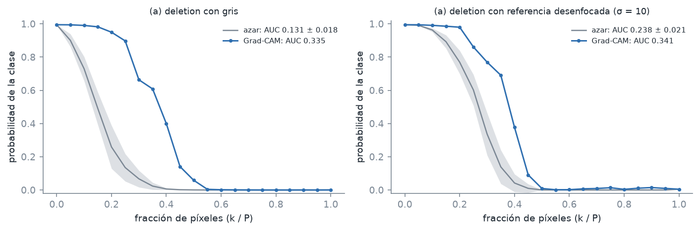

*Figura 24. Deletion de la imagen (a) con referencia gris y con referencia desenfocada, frente al azar.*

Con la referencia desenfocada, el AUC_del del mapa cambia +0.0067 y el del azar +0.1068: los parches grises castigan
sobre todo al orden aleatorio, porque introducen bordes artificiales que la red no vio en el entrenamiento. La desventaja del mapa se reduce de 11.3 a
4.9 desviaciones estándar, pero no desaparece: aun con desenfoque, cambiar píxeles dispersos degrada la textura de toda la imagen. Por eso
deletion con órdenes aleatorios a nivel de píxel no es una referencia justa para un mapa de 7×7; insertion, o un azar que permute celdas de 32×32,
mide mejor la calidad del mapa.

### (b) Sensibilidad a los parámetros del modelo

Etapa en la que el Spearman cae por primera vez por debajo de 0.3: (a) etapa 2 (`layer4`), (b) etapa 1 (`fc`), (c) etapa 2 (`layer4`).

**Predicción.** En ResNet-18, α_k^c = w_k^c / Z, de modo que L^c = ReLU(Σ_k w_k^c A^k / Z). Si sólo se aleatoriza `fc`, las activaciones A de `layer4`
no cambian (diferencia máxima medida: 0.0e+00) y el nuevo mapa es exactamente Σ_k w_k^rand A^k / Z: una combinación con pesos al azar
de los mismos 512 mapas de activación. Debería perder la relación con la clase y conservar sólo la estructura espacial común a todos los canales
(dónde hay activación en general), así que la correlación con el original debería caer muy por debajo de 1 y quedar con un signo y una magnitud
que dependen del sorteo de los pesos.

**Comparación con la etapa 1.** La identidad se cumple con error máximo de 9.3e-09 entre el mapa calculado y Σ_k w_k^rand A^k / Z. Los Spearman
de la etapa 1 son (a) +0.389, (b) -0.214, (c) +0.448, todos lejos de 1. Lo que queda de correlación sale de la estructura común: el
Spearman entre el mapa original y la suma sin pesos Σ_k A^k es (a) +0.967, (b) +0.313, (c) +0.907, y la suma de los pesos
aleatorios de la clase es (a) +0.505, (b) -0.435, (c) +0.074. En (a) y (c) la suma de pesos aleatorios es positiva y el mapa original se parece a Σ_k A^k, así que el mapa aleatorio conserva una correlación positiva con el original. En (b) la suma es negativa y la correlación también lo es. Grad-CAM **pasa** la prueba de aleatorización: el mapa depende
de los parámetros que la red aprendió, y desde la etapa 2 la correlación queda por debajo de 0.3 en las tres imágenes. Aun así, la etapa 1 muestra
un riesgo práctico: con una capa final al azar el mapa puede seguir marcando el objeto, sólo porque ahí se concentra la activación, y verse
"plausible" sin decir nada sobre la clase.

### (c) Explicaciones para distintas audiencias

| Audiencia | Qué se entrega | Validaciones con números propios | Qué **no** se entrega |
|---|---|---|---|
| Persona solicitante | Las razones principales del rechazo en lenguaje llano a partir de SHAP (en el cliente rechazado: `duration` = 36 (-0.93), `savings_status` = no known savings (+0.88), `other_payment_plans` = bank (-0.81)) y un contrafactual accionable del 3.4 (checking_status de 0<=X<200 a no checking; duration de 36 a 30; credit_amount de 3990 a 3780; P(good) pasa de 0.087 a 0.530), sin cambiar variables inmutables. | El contrafactual se comprueba con el propio modelo (P(good) ≥ 0.5) y sólo cambia variables accionables; las razones SHAP suman exactamente el puntaje (error de eficiencia 9.7e-08). | Coeficientes de LIME (R²_w máximo 0.301 y top-5 inestable), códigos ordinales, el modelo o umbrales internos, ni contrafactuales que toquen `age`, `personal_status` o `foreign_worker`. |
| Oficial de cumplimiento interno | SHAP local de cada decisión y SHAP global (importancia media \|φ\|) junto con la importancia por permutación; contrafactuales para revisar si las acciones sugeridas son razonables. | Eficiencia 9.7e-08; valor base igual al promedio del fondo (diferencia 0.0e+00); Spearman entre importancias 0.645; Shapley exacto propio contra TreeSHAP con error 2.4e-08; KernelSHAP con MAE 0.030 respecto de TreeSHAP; LIME con Jaccard de 0.70 a 0.94 según N y σ_rel (hacen falta unas 3600 muestras para 0.9). | LIME como justificación de una decisión (no alcanza R²_w ≥ 0.8) ni importancias individuales de variables correlacionadas sin agruparlas (con una copia ruidosa, la original se queda con 54% del crédito). |
| Regulador | Documentación del modelo y del método: datos, codificación (ordinal, con su limitación), desempeño (AUC 0.765, exactitud 0.775), importancia global SHAP y por permutación, y el protocolo de explicaciones individuales con sus pruebas. | Todas las verificaciones numéricas anteriores, el reparto del crédito entre variables duplicadas (2.3), la estabilidad de LIME (3.2) y la validación de Grad-CAM del Task 4 como ejemplo de que una explicación debe compararse con el azar y pasar la prueba de aleatorización. | Explicaciones aisladas sin su validación, ni una sola corrida de LIME o una sola semilla presentadas como si fueran estables. |

**Contrafactuales en un sistema de detección de lavado (Proyecto 2).** Un contrafactual como el del 3.4 le dice a quien es evaluado qué cambio mínimo
haría que el modelo cambiara de decisión. En crédito eso es deseable porque el cambio (pedir menos monto o plazo) es legítimo. En detección
de lavado, la persona evaluada puede ser el adversario: "si la transferencia fuera menor que X o se repartiera en N operaciones no se
marcaría" es una receta para evadir el modelo (fraccionamiento, cambio de contrapartes), y repetir consultas permite reconstruir la frontera de
decisión. Además, avisar al cliente de que está siendo investigado está prohibido en la normativa antilavado (*tipping off*). En su lugar se
entregaría al cliente sólo una notificación genérica del resultado y el canal de revisión, y las explicaciones SHAP locales y globales se
reservarían para los analistas y el oficial de cumplimiento, con registro de accesos y sin publicar umbrales ni contrafactuales.

**Prompt utilizado**

Con el enunciado del Laboratorio 10 y el repositorio (Grad-CAM propio del Task 1 en `gradcam.py`), implementa el Task 4 con la
misma estructura que los demás (`task4.py`, `viz_task4.py`, `console_task4.py`, `report_task4.py` y `scripts/run_task4.py`), sin
`pytorch-grad-cam` ni `captum`. En 4.1 ordena los 224×224 píxeles por el mapa normalizado de la clase top-1; en P = 20 pasos reemplaza por gris
medio (deletion) o inserta sobre la imagen desenfocada con σ = 10 (insertion) la fracción k/P, trabajando en [0, 1] y normalizando justo antes
del modelo, y compara con 10 órdenes aleatorios con semilla. En 4.2 reinicializa con `reset_parameters` de PyTorch, de forma acumulada, `fc`,
`layer4`, `layer3`, `layer2`, `layer1` y `conv1`, y calcula el Spearman entre mapas de 7×7 de la clase original. Para 4.3 corre los
experimentos que piden los incisos (deletion de (a) con referencia desenfocada y la comprobación de que, con sólo `fc` aleatorio, el mapa es
Σ_k w_k A^k / Z con las activaciones originales) y usa los números de los Tasks 2 y 3 para la parte de audiencias. Imprime verificaciones
numéricas con tolerancia.

**Por qué funcionó este prompt**

Nombrar el espacio de píxeles ([0, 1] antes de normalizar), el gris, el desenfoque y las semillas evitó ambigüedades que cambian las
curvas, y exigir comparación contra órdenes aleatorios convirtió cada AUC en una cifra interpretable. Pedir la comprobación de α = w/Z en la
primera etapa de la cascada transformó la "predicción" del 4.3(b) en una prueba numérica (error del orden de 1e-8), y obligar a usar los
números de los Tasks 2 y 3 en 4.3(c) evitó recomendaciones genéricas para cada audiencia.

<!-- INFORME_TASK4:FIN -->
